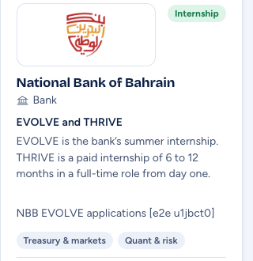
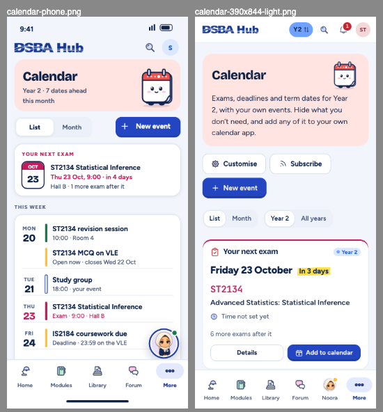
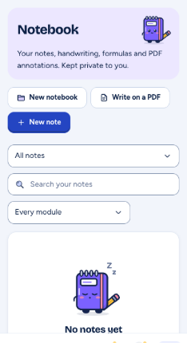

# UI/UX review: DSBA Hub on the real API

## Round 15: the Deskmates look (20 October 2026)

Reviewer: UI/UX. Build: `feature/backend` at `39680d2` (phases 1, 2, 3a and 3b merged), on the shared stack (app
:5173, API :8000). No application code was changed.

**Brief.** Judge the whole app against the approved Deskmates target (`docs/design/deskmates/README.md`,
`brand/BRAND.md`, `screens/renders/*.png`, `v2/renders/*.png`) and the hub's rules: fidelity, consistency between
the redone screens and the ones not yet redone, accessibility, responsive layout, copy, and Mini Noora at rest.

**Method.** Playwright 1.56 driving the installed Google Chrome, reduced motion on. Made-up accounts by dev-login:
`ux15-y2@example.com` (Year 2, the main persona), `ux15-y1@example.com` (Year 1, no notes), `ux15-rep@example.com`
(rep), and a guest.
- **Sweep:** 28 screens at 360×780, 390×844, 844×390, 768×1024, 1024×768, 1440×900, 2560×1440 and 3440×1440, in
  light and dark (448 loads). Each load was checked for sideways scroll, elements past the edge, unlabelled fields,
  line length, page errors, deskmates (count, size, state) and where Mini Noora sits. Phones were also shot as full
  pages.
- **Touch targets:** a separate pass with touch emulated at the five phone and tablet sizes. Full-page screenshots
  drop Chrome's touch emulation, so the sweep's own target numbers weren't used.
- **Contrast:** axe-core 4.10 (WCAG 2.1 AA) on 23 screens at 390 and 1440, in both themes. Every hit was checked by
  eye.
- **Flows:** ⌘K on phone, landscape and laptop, including a typo and an empty result; the Noora panel; New event;
  the calendar list and an event's drawer; a new note on a phone; the account menu and bell by keyboard; Tab order and
  the focus ring; sign-in with a bad address; Upload a file at 390 and 844×390.
- **Icons:** each screen's SVGs counted by family (Deskmates 24-grid or Phosphor 256-grid), and the rows that mix
  both were listed.
- **Screenshots:** looked at directly, side by side with the renders. The full set is in the session's scratchpad
  (`r15/`). The crops behind findings are in `screens/ux15-*`.

**Test data I left:** one untitled note in Test Y2's "My notebook".

### Summary

**The new look holds together on the screens that were redone.** Library, the module page, the forum and its
threads, the calendar, ⌘K, Noora's panel and the notebook all use the v2 tokens, Bricolage and Figtree, the
two-tone icons and their section's colour and deskmate. ⌘K is the closest to its mockup: Loupe sits in the field, and
a typo gets "Nothing matched 'regresion'. Showing results for 'regression'". Dark mode is consistent everywhere.

**The basics pass.**
- Nothing scrolls sideways in any of the 448 loads, and there were no page errors.
- Dialogs fit 844×390: New event, Upload a file, sign-in, ⌘K and Noora.
- Focus moves into each dialog and comes back to the button that opened it. The account menu works by keyboard, and
  the focus ring shows.
- Deskmate motion is wrapped in `prefers-reduced-motion: no-preference`.
- **Mini Noora never covers content at rest.** Phones have her as a tab-bar item. On tablets and laptops she stands
  in a lane of her own beside the content, and the lane held at every size.

**What needs work, most important first:**
1. **Career Navigator hides its application dates** (UX-80). "Closes 30 October" is white on a white card.
2. **On phones, the redone bands are still desktop headers** (UX-81). The calendar's next exam starts at 489 px and
   the forum's first thread at 641 px. In the mockups they start at about 300 and 370. The library, at 299 px, shows
   how it should work.
3. **Two deskmates in one view** on empty states (UX-82).
4. **Both icon families in one row** on redone screens (UX-83).
5. **⌘K can't find the Notebook or Daily** (UX-84).
6. **Contrast:** year avatars (UX-85), and past events plus the highlighter yellow in the calendar (UX-86).

**Counts:** 1 major, 9 minors and a group of nits (UX-80 to UX-91). Seven earlier findings were re-checked (table
below).

### Screens still in the old look

These have the new tokens and fonts from phase 1, but not the Deskmates layout. None has a band; all use Phosphor
icons, not the Deskmates family. BRAND §2 gives the tools Home's tones and no mate.

| Screen | What still looks old |
|---|---|
| Boards (`/board`) | Bare title on the canvas. Template cards with coloured dots. 11 Phosphor icons, no Deskmates icon |
| Grades | "Type a mark / to see your class" as grey display type (UX-35). 7 Phosphor icons |
| Career Navigator | 73 Phosphor icons. Cards and the green callout from round 13. The dates bug (UX-80) |
| Newsletter (list, issue, editor) | Its own editorial masthead (the yellow-marked "DSBA", a giant issue number). 6 and 13 Phosphor icons |
| Daily (hub and games) | Raster illustration tiles from the round 4 art. Phosphor stat icons. Underlined tabs |
| Manage and Access | Bare title. 11 Phosphor icons. Empty states use a ticked circle |
| Your account | Bare title. Phosphor icons |
| Requests, Start here | Phosphor icons. Requests mixes the two families in one row |
| Sign-in dialog, 404, thread not found | Plain style (right for errors). The icons are Phosphor |
| Modules index (`/modules`) | The band is new. The list keeps the raster module art and 9 Phosphor icons, with no Deskmates icon |
| Lesson panel (module Lessons tab and lesson pages) | 16 Phosphor icons: Take notes, Add to my board, Previous, Next video, Open on YouTube |
| Home's "My modules" cards | Raster module art. The mockup has a coloured binder per module and a lesson progress bar |

### Earlier findings (re-checked)

| ID | Was | Now | Evidence |
|---|---|---|---|
| UX-35 | minor | **open** | "Type a mark" is still display type at 390. The first mark field is below the fold. |
| UX-37 | minor | **fixed** | At 390 the paper page shows its pages in place ("4 pages", with Open in your PDF viewer as an option). |
| UX-62 | minor | **partly fixed** | The library's chips now sit behind Filters on phones. The forum's category tabs still stop mid-label at 360 and 390 ("Year 3", "Study…"). |
| UX-78 | minor | **fixed** (`round15/polish`) | An empty Notebook is the band and its empty state: Write your first note and Write on a PDF, no filters. |
| UX-79 (lesson back arrow) | nit | **fixed** | The touch pass found no target under 44 px on the lesson header. |
| UX-79 (New event) | nit | **open** | Starts is still empty while All day is off. |
| UX-79 (others) | nit | not re-checked | |

### Responsive results

- **Sideways scroll:** none, in 448 loads (28 screens × 8 sizes × 2 themes).
- **Touch targets** (with touch emulated at 360, 390, 844×390, 768 and 1024×768): pass, with three exceptions:
  - Mini Noora's launcher is 40×84 on touch tablets and in landscape (UX-87).
  - Library card titles (21 px) and forum row titles (19 px) are links. Each card also has a 44 px Open, so this is
    acceptable.
  - Sign in is 43×44.
- **Dialogs on short screens:** all fit at 844×390 with their actions in view.
- **Measure:** prose stays at or under 68ch at every size, including 2560 and 3440.
  - Pages are capped at 1,430 px (default) and 1,710 px (wide), centred.
  - Page prose measured 64ch.
  - The long lines the script reported are list containers, not text.
- **Landscape phones (844×390):** Mini Noora's figure runs to 857 px, 13 px past the edge. It's clipped, and the page
  doesn't scroll sideways. The icon rail shows about three items at once in a 149 px scroll area (already accepted in
  round 10).
- **Dark:** consistent on every screen at 390 and 1440. Deskmates get their halo.

### New findings

| ID | Severity | Title |
|---|---|---|
| UX-80 | major | Career Navigator: application dates are invisible |
| UX-81 | minor | Phones: section bands are desktop headers, and the first item starts 200–270 px lower than in the mockups |
| UX-82 | minor | Two deskmates in one view on empty states |
| UX-83 | minor | Both icon families in one row on redone screens |
| UX-84 | minor | ⌘K can't find the Notebook or Daily, and page names differ from the nav |
| UX-85 | minor | Year avatars' initials fail AA in light; avatar classes keep the old token names |
| UX-86 | minor | Calendar: past events fall below AA, and deadlines use the highlighter yellow |
| UX-87 | minor | Mini Noora's launcher isn't the mockups' ring, and it's 40 px wide on touch |
| UX-88 | minor | Notebook: "New note" opens "New notebook", and the phone editor isn't the mockup's |
| UX-89 | nit | Deskmates are smaller than BRAND's sizes on phones, and larger on the module page |
| UX-90 | minor | Tools pages have no band, so the app changes style halfway down the sidebar |
| UX-91 | nit | Small leftovers |

#### UX-80 Career Navigator: application dates are invisible (major)

- **Where:** Career Navigator, the employer cards with an application window from the calendar (for example
  National Bank of Bahrain). Every size, both themes.
- **What a student sees:** a blank line between "Bank" and the window's title, where "Closes 30 October" should be.
  The link is white on a white card in light (1:1) and navy on navy in dark (1.09:1, axe). The one fact a student
  opens this card for, when applications close, can't be read. It's still a link that can be tabbed to, with no
  visible text. 
- **Cause:** `features/career/Opportunities.css`, `.career-emp__dates a { color: var(--on-accent) }`. `--on-accent` is
  text *on* an accent fill, not text on a card.
- **Fix:** `color: var(--accent-text)`. Better, set it as the calendar's deadline line ("Closes Thu 30 Oct · 11 days
  left") in `--warning`, like the calendar's own deadlines.

**Fixed** (phase 3c, checked in `round15/polish`): the window line is `--accent-text` on the card
(`career/Opportunities.css`), readable in both themes.

#### UX-81 Phones: section bands are desktop headers, and the first item starts 200–270 px lower than in the mockups (minor)

- **Where:** Calendar, Forum, Notebook and Modules at 360 and 390 (and 844×390, where the band fills the screen).
- **What a student sees** (390×844, where the first item starts):

  | Screen | Band | First item | Mockup |
  |---|---|---|---|
  | Calendar | 311 px, four lines of lede, then Customise, Subscribe, New event and two segmented controls | next exam at 489 px | about 300 px, with This week visible |
  | Forum | 293 px, a three-line lede and a stats line, then Start a thread, the tabs, Search threads, two chips and Hot/New/Top | first thread at 641 px | about 370 px |
  | Notebook | 262 px, then three create buttons and three filters | the empty state at 601 px | at the top, no band |
  | Modules | 279 px | first module at 384 px | |
  | Library (the good one) | 75 px band with the count | first file at 299 px | |

  
- **Why it matters:** students open these between lectures to check one thing (the next exam, a reply). A whole
  screen of header before it is the round 14 problem (UX-66) again, on the screens that were just redone.
- **Fix** (to the mockups' phone rule):
  - Under 600 px a band holds the title, **one** stat line and the deskmate: "Year 2 · 7 dates ahead this month",
    "14 replies today · 3 questions waiting". The lede is for laptops.
  - Secondary actions (Customise, Subscribe) go into a "More" menu.
  - The primary action sits on the view switch's row (List | Month … New event), as in `calendar-phone.png`.
  - The forum's search, chips and sort fold into one Filters button, as the library already does.
  - The Notebook's filters show only when there are notes (UX-78).

**Fixed** (`round15/polish`). Under 700 px, and on short screens, a section band is the title, one stat line and the
deskmate (`ui/Page.css`); the lede is for laptops. Measured at 390×844 (before → after):
- Calendar: the next exam 489 → 262 px; the month grid 611 → 314 px (the type chips go under the grid on phones).
  The band reads "Year 2 · 5 dates ahead this month"; List | Month shares its row with New event and a ⋯ menu
  (whose dates, Customise, Subscribe, Programme date).
- Forum: the first thread 591 → 378 px. The search and one Filters button share a row; the chips and the sort are in
  the Filters sheet.
- Notebook: an empty Notebook is the band and the empty state (the empty state 565 → 183 px); with notes, New note
  and a ⋯ menu (Write on a PDF, New notebook).
- Modules: the band 279 → 154 px ("6 modules · 162 video lessons"; the year and the next exam are on the switch and
  the rows).
- Home: the shelf wraps three over two at 360–430 px, every tile in view, Calendar's "Exam Fri" included.
- 844×390: the bands drop their lede, and the calendar's buttons go on the bar.

#### UX-82 Two deskmates in one view on empty states (minor)

- **Where:** an empty Notebook (`/notes` for a student with no notes) and a library search with no results. Every
  size.
- **What a student sees:** Jot idle in the band (72 px), and below it Jot asleep in the empty state (116–160 px).
  Stacks does the same in the library. BRAND §6: "One mate per view. Two mates never compete." The approved
  `empty-notes-phone.png` has no band mate.
  
- **Fix:** when an `EmptyState` with a `mate` is on screen, the band leaves its deskmate out, or the band takes the
  sleepy state and the empty state shows none. One rule in `SectionHeader`/`EmptyState` covers both screens.
- **Home is fine:** Lumen, the shelf's mates, Blink beside Up next and Pip and Pod beside Replies are all allowed by
  BRAND §6.

**Fixed** (`round15/polish`): when an empty state shows its sleepy deskmate, the band leaves its own out (one rule in
`ui/Page.css`, `.ui-page:has(.ui-empty__mate)`, which also covers the module page's Binder). An empty Notebook shows
Jot once, asleep.

#### UX-83 Both icon families in one row on redone screens (minor)

- **Where** (1440, counted by SVG grid):
  - **Module header:** "Plan my revision" (Phosphor) beside Lessons and Past papers (Deskmates).
  - **Lesson panel:** 16 Phosphor icons beside the Deskmates tabs.
  - **Paper page:** "Add to my board" and "Tag a question" beside Deskmates star and download.
  - **Calendar band:** "Subscribe" (Phosphor) between Customise and New event.
  - **Home's daily question:** "Open the question" and "Add to my board".
  - **Forum sidebar:** the guidelines list.
  - **Library:** the results bar's "Ask for it".
  - **Requests:** its header row.
- **What a student sees:** two drawing styles side by side: 1.75 px two-tone icons next to Phosphor's thin
  single-tone ones. BRAND §5 and §7: "never put both families in one row … swap a whole surface at once".
- **Fix:** the family already has every one of these:
  - Add to my board → `boards`
  - Take notes → `notebook` or `pen`
  - Subscribe → `link` or `calendar-add`
  - Previous and Next → `chevron-left` and `chevron-right`
  - Open on YouTube → `external`
  - Plan my revision → `calendar-add`
  - Tag a question → `flag` or `edit`

  Then swap the rest of the lesson panel at once.

**Fixed** (`round15/polish`): Subscribe (`link`), Tag a question (`edit`, with `flag` and `trash` beside it), the
daily question's Open (`forward`), the Modules index, and the lesson panel and chapter list (`external`,
`chevron-left/right`, `pen`, `check`/`success`, `calendar`, `warning`, `offline`, `more`, `undo`, `eye-off`) are
brand icons. Plan my revision and Add to my board already were. Missing from the brand set, so left in Phosphor in a
row of their own: Headphones (Chapter audio), and the Play and CheckCircle badges drawn on lesson thumbnails.

#### UX-84 ⌘K can't find the Notebook or Daily, and page names differ from the nav (minor)

- **Where:** ⌘K, signed in, any size.
- **What a student sees:**
  - "notebook" returns three past papers that contain the word, and no Notebook page.
  - "daily" returns three files, and no Daily.
  - "grades" lists three examiners' reports before "Grade calculator".
  - The nav says "Grades", the palette says "Grade calculator".
  - The palette's Go to list says "The DSBA newsletter" while its result group says "The DSBA Newsletter".
- **Fix** (`features/search/search.ts`, the `pages` list):
  - Add Notebook, Daily, Noora and Requests, with keywords (notes, puzzles, word, sudoku).
  - Rank a page whose name matches above full-text file hits.
  - Use the nav's names: Grades, The DSBA Newsletter.

**Fixed** (`round15/polish`): ⌘K lists Notebook, Daily puzzles, Noora and Requests, with keywords. Pages take the
nav's names (Grades, Newsletter, Daily puzzles), so a page whose name matches leads. In the browser, "notebook",
"daily", "grades", "newsletter" and "requests" each put their page first, above the files. Unit-tested in
`search.test.ts`.

#### UX-85 Year avatars' initials fail AA in light; avatar classes keep the old token names (minor)

- **Where:** every avatar with a year tone: the forum sidebar (Helpful this week), the profile button, newsletter
  bylines, notebook and thread bylines. Light theme.
- **What a student sees:** 12 px initials at 3.62:1 (Year 3), 3.59:1 (Year 1) and 4.19:1 (Year 2). The success tone
  is 4.2:1 at 9 px. Dark passes.
- **Cause:** `ui/Avatar.css` mixes 62% of the year *fill* with ink for text on 18% of the fill.
- **Fix:**
  - Use the pairs BRAND §2 already checked: `--y1-strong` on `--y1-soft`, and the same for Years 2 and 3.
  - Rename `.ui-avatar--cobalt`, `--signal` and `--alert` to `--accent`, `--success` and `--error`, to match the
    phase 1 token renames.

**Fixed** (`round15/polish`): each avatar tone is a checked pair (`--y1-strong` on `--y1-soft`, and accent, success
and error the same way); the classes are `--accent`, `--success` and `--error`. Measured on the forum at 1440: Year 1
4.90:1, Year 2 4.79:1, Year 3 4.94:1, success 4.73:1, error 5.02:1 in light; 5.3–7.2:1 in dark.

#### UX-86 Calendar: past events fall below AA, and deadlines use the highlighter yellow (minor)

- **Where:** Calendar month, 1440 (and wherever past chips show). Light.
- **What a student sees:**
  - Earlier this month, chip titles are 2.96:1 (Event), 2.77:1 (Revision) and 3.91:1 (Mock exam). `.cal-chip.is-past`
    sets `opacity: .7` on the whole chip.
  - Deadlines (chips, dots, the legend, "In 3 days" on Your next exam) use `--highlight` (#FFE14A). BRAND keeps that
    for highlighter marks only; the mockups' deadline is `--warning-fill` #FFC233.
- **Fix:**
  - For past chips, keep the fill and set the title in `--ink-3`, without opacity.
  - Map the deadline tone to `--warning-fill` (`calendar-shared.css`, `eventMeta.ts`).
  - Set the next-exam countdown as the mockup does: "Thu 23 Oct, 9:00 · in 4 days" in the exam tone, with no marker.

**Fixed** (`round15/polish`): a past chip dims its fill (45% into the surface) and keeps its words at full strength:
Event 5.56:1, Revision 5.10:1, Mock exam 9.26:1 in light (6.4–8.1:1 in dark). Deadlines use `--warning-fill` (chips,
dots, the legend, the leaf, the badge tone `warning`). The next exam's countdown is in the exam tone, with no marker.

#### UX-87 Mini Noora's launcher isn't the mockups' ring, and it's 40 px wide on touch (minor)

- **Where:** tablets, laptops and monitors, and 844×390.
- **What a student sees:**
  - **Placement passes the brief.** Noora never covers content at rest. On phones she's a tab-bar item, which is
    better than the mockups, where she covers a card (README open item). From 768 up she stands in a lane of her own
    beside the content.
  - **But she isn't the approved launcher.** It's the full standing figure (54×112 at 1440). `noora-laptop.png`,
    `noora-phone.png` and every screen render show a 64 px bust in the logo-blue ring with the online dot.
  - **Touch:** under touch the hit area is 40×84, under 44 px wide.
  - **Landscape:** at 844×390 her image runs to 857 px, 13 px past the edge, and is clipped.
- **Fix:** Mohamed's call. Either build the ring launcher from the renders (64 px, in the same lane), or keep the
  figure and give it a 44 px wide hit area and a 16 px inset in landscape.

**Fixed** (`round15/polish`, Mohamed kept the standing figure): her box is at least 44 px wide (44×84 below 1100 px,
so the lane is 60 px), and a clip-path trims her sprite's empty canvas at the window's edge (`layout.ts` `edgeClip`,
unit-tested). At 844×390 nothing is drawn past 844 px. The sprite's image box still reaches 854 px, but that part is
transparent and clipped.

#### UX-88 Notebook: "New note" opens "New notebook", and the phone editor isn't the mockup's (minor)

- **Where:** `/notes` and a note, 390 and 1440.
- **What a student sees:**
  - **The action changes name.** With no notebook, **New note** opens a dialog titled **New notebook** ("Notebook
    title", Create). The note then opens "Saved in My notebook".
  - **The phone toolbar isn't the mockup's.** It sits at the top, as Text/Pages tabs, undo/redo and a formatting row.
    `notebook-phone.png` puts the five tools in a bottom bar where thumbs reach, with B and Σ.
  - **The toast covers the page.** On the first save, "Saved · Your note saves as you write" sits over the lower
    writing area for several seconds.
  - **"Add a module" is in JetBrains Mono.** BRAND §3 keeps mono for codes and the timer.
  - **The back link reads "Notes"** (aria "All notes") in the Notebook section.
- **Fix:**
  - New note makes or uses a default "My notebook" silently and opens the note with the cursor in it.
  - The back link says "‹ Notebook".
  - "Add a module" goes in Figtree.
  - On phones, the save toast shows once and as the mockup's compact pill, "Saved · In ST2134 …", clear of the text.
  - The bottom tool bar is phase 3b's open item.

**Fixed** (`round15/polish`). New note starts a note and opens it (checked at 390 and 1440 with a student with no
notebook: no dialog). The back link says "Notebook". "Add a module" is in Figtree. The first-save toast is a compact
pill over the tab bar ("Saved · Your note saves as you write.", 3 s). An empty Notebook offers Write your first note
and Write on a PDF, with no filters (UX-78). The phone's bottom tool bar stays open (not asked for this round).

#### UX-89 Deskmates are smaller than BRAND's sizes on phones, and larger on the module page (nit)

- **What I measured:**
  - Band deskmates are 60–72 px at 360–390 (Library 64 px, the module's Binder 64 px). BRAND §6 says 98–104, or
    80 at 360.
  - The Home shelf's mates are 44 px on phones (BRAND: 56).
  - Binder is 112 px at 1440 (BRAND: 98–104).
  - None is under 32 px, and states are used correctly: idle in bands, sleepy only on empty states and on Home after
    23:00 or offline, happy on the save toast, Blink's countdown on Up next.
- **Fix:** once the phone bands are one-line (UX-81), 64–72 px is the right size there. Write that size into BRAND §6
  rather than grow the mates. Bring Binder to 104 px.

**Fixed** (`round15/polish`): Binder is 104 px on laptops; Home's shelf mates are 56 px on phones; BRAND §6 now gives
the phone band's mate as 64–72 px (60 under 375 px) and the compact toast's as 32 px.

#### UX-90 Tools pages have no band, so the app changes style halfway down the sidebar (minor)

- **Where:** Boards, Grades, Career Navigator, Newsletter, Daily, Manage, Account, Requests (list above).
- **What a student sees:** every section above "Tools" in the sidebar opens on a coloured band with its deskmate.
  Every tool opens on a bare title on the canvas, with Phosphor icons and the round 13 card styles. Going from the
  Calendar to Boards feels like a different app.
- **Fix:**
  - Give tools the band without a mate, in Home's tones (pill `#E3E9FF`, `#1E2C66` in dark), as BRAND §2's tools row
    says, with the title, one stat line and the primary action.
  - Swap their icons to the Deskmates family, a whole page at a time.
  - Daily's raster tiles and the newsletter's masthead are design calls for Mohamed. The masthead is a deliberate
    editorial look and can stay.

**Fixed** (phase 3c, then phase 3d in `round15/screens4`): every tool and staff page opens on the tools band in
Home's tones with no deskmate. Phase 3c did Boards, Grades, Career Navigator and Your account; phase 3d did the rest:
- **Manage:** the band, and the tool list styled like the app's nav (Home's pill, brand icons, heavier when active).
  The Numbers are index cards. The queues and editors have 1.5 px cards with the card shadow, and brand icons.
- **Access:** the band and brand icons on its tabs.
- **Newsletter:** the band on the list, the editor and the not-found pages. On an issue, the running head is a slim
  band over the issue's own editorial masthead, which stays.
- **Daily puzzles:** the band, with how today stands as pills. A game's bar is a slim band, and its controls use brand
  icons. The boards and their colours are unchanged.
- **Requests, Start here, Results day and the 404 page:** the band. A request's head is a slim band, and "Me too"
  uses the brand vote icon.

These Phosphor icons stay, each in a row of its own family:
- the Daily streak's flame and freeze, the badges in Your stats, the leaderboard's empty trophy and the keyboard's
  backspace;
- the newsletter's own section, reaction, poll and block-kind icons, plus WhatsApp in its share menu (a logo);
- Manage's "switched off" empty state (Power) and the empty Bugs list (Bug).

#### UX-91 Small leftovers (nit)

- **Thread on phones:** "Accepted answer" wraps onto its own line under the name, with the time on a third line. In
  `forum-thread-phone.png` it sits on the name row. Put it after the time, or let the success rule carry it.
- **Nav name:** the nav says "Daily", while BRAND and the mockups say "Daily puzzles".
- **Notebook in dark:** a typed page stays a white lined sheet, which is bright at night. Use the inset surface for
  typed pages and keep white for PDFs.
- **Home's "My modules"** use the older raster module art. The Home mockup uses a coloured binder per module with
  lesson progress.
- **Phone band text:** the band ledes run as long as the laptop ones (four lines on the calendar at 390). They go
  with UX-81.

**Fixed** (`round15/polish`), except the notebook in dark:
- "Accepted answer" follows the time on the second line on phones.
- The nav and ⌘K say "Daily puzzles".
- Home's My modules are coloured binders with the lesson count and the progress bar.
- The band ledes are gone on phones (UX-81).
- **Open:** a typed page in dark stays white. Pens keep the colours they were drawn in (navy and black among them),
  so a dark page needs an ink colour mapping first: a design call.

### What works well and should stay

- **⌘K:** the whole palette, Loupe in the field, typo correction, grouped results with counts, "Search somewhere
  else", and focus that goes in and comes back.
- **Library on phones:** a one-line band, the search, one Filters button and the first file at 299 px.
- **Forum threads:** the cards, the accepted answer's success rule and one reply box. Close to the mockups.
- **Mini Noora at rest:** a tab-bar item on phones and her own lane from 768 up. She never covers content.
- **Dark mode:** the section tones, the halos and the exam raspberry all read well.
- **Calendar dialogs:** the event drawer and New event fit 844×390 and return focus to the button that opened them.
- **Accessibility:** no unlabelled fields on any screen. Reduced motion stops every deskmate animation.


## Round 14: the study core (19 October 2026)

Reviewer: UI/UX. Build: `feature/backend` at `c4e345d`, on the shared stack (app :5173, API :8000). No application
code was changed.

**Brief.** Mohamed: the hub's value is the study core, not Daily. I judged the sections students open several times
a day, as a student who already has VLE, WhatsApp groups and a Google Drive of papers. For each one I asked what
would make them reach for the hub first. Daily is out of scope.

**Method.** Playwright 1.56 driving the installed Google Chrome. Made-up accounts by dev-login:
`ux14-y1@example.com`, `ux14-y2@example.com` (the main persona), `ux14-y3@example.com`, `ux14-rep@example.com`, and
a guest.
- **Sweep.** 15 core routes at 360×780, 390×844, 768×1024, 1440×900 and 2560×1440 in light, and 390 and 1440 in
  dark (110 loads). Phones and tablets with touch emulated. Each load checked for sideways scroll, elements past the
  edge, touch targets, unlabelled fields, line length and page errors. Phone pages were also shot scrolled.
- **Flows by script:**
  - library: filter to one module's past papers, grid and list, a paper and a student's note;
  - module: the Files and Discussion tabs, a lesson;
  - search: ⌘K on a phone and at 1440 with five real queries;
  - forum: a Year 1 thread, a Year 2 reply, and Year 1's bell;
  - calendar: New event at 390 and 844×390;
  - grades: marks typed in;
  - notebook: a new note typed on a phone;
  - upload: the dialog from a module;
  - empty searches, Time me on a phone, and cold loads on a throttled connection (600 ms latency, 50 kB/s).
- **Screenshots.** Looked at directly. The full set is in the session's scratchpad (`r14-coreux/`), and the crops
  that back findings are in `screens/ux14-*`.

**Test data I left:**
- the thread "[ux14] How many marks is the MGF proof usually worth?" (Test Y1) and one reply (Test Y2);
- one note in Test Y2's notebook.

The library still holds e2e leftovers.

### Summary

**The core works.** Nothing scrolls sideways at any size, in either theme. Dialogs fit 844×390. The forum round
trip (post, reply, bell) is quick and clear, the upload dialog fills in the module and type from where you are, empty
searches invite an action, and the round 13 phone fixes hold: Time me opens its timer, and lessons lead with the
video.

**What stops a student reaching for it first** is the number of taps and scrolls to the thing they came for, and
papers that can't be told apart:
- On a 390 phone the library shows **no file on its first screen**: the first one starts at 812 px of 844.
- Past papers are listed by their **raw file names**: "ST2133 - Advanced Statistics - Distribution Theory - 2019
  Exam - Zone-A". Every phone list, the paper page's "More from this module" and search cut that name off before the
  year and zone, so 29 rows read the same.
- The module page is the natural home for a module, but on a phone its header fills the first screen. Its Overview
  then sends you on with buttons ("Open 2 files", "See past papers") instead of showing the papers, notes, threads
  and dates it already has.
- In the notebook on a phone, **typed text is 7 px tall**, and a new note doesn't put the cursor anywhere.

**Counts:** 4 majors, 9 minors and a group of nits (UX-66 to UX-79). Ten earlier findings re-checked (table below).

### Where to put design effort next

1. **The library: browsing and a paper's page.** Students come here most and leave fastest when it fails; the
   alternative is "does anyone have the 2019 paper?" in WhatsApp. The data is already good: sittings, zones, reports
   and solutions are linked, and examYear, examSession and zone are on every paper. The presentation hides it: raw
   names, filters before files, a cover grid for papers that look alike, and Download three times on the paper page.
   UX-66, UX-67, UX-68, UX-71 and UX-72 are one piece of work.
2. **The module page as the module's home.** Home's "My modules" (with exam dates) and search already lead here.
   If the Overview showed the last three sittings, the newest notes and who wrote them, the module's threads, your
   notes and the next dates, a student would open ST2133 instead of four apps. UX-69 is the fix; IDEA-40 and IDEA-41
   in `docs/ideas.md` are the links that need new data.
3. **The notebook on phones.** It is the one core feature that is broken rather than slow on a phone: 7 px text and
   no cursor (UX-70). Typed notes between lectures are its most common use. Notes also stand alone: a note doesn't
   know its module, so it never turns up beside the lesson or paper it's about (IDEA-41).

Home, the forum and the calendar are in good shape and need polish only (UX-73 to UX-77). Grades, Career Navigator
and the newsletter are visited rarely enough that their current density is fine.

### Section by section: what would make it the first place a student goes

- **Library.** Get to a file in one screen: search plus one "Filters" button on phones, then rows that say "May
  2019 · Zone A · Report · Solutions". Newest sitting first. Show who shared a note. Make "My modules" the default
  scope for a signed-in student rather than the whole year.
- **A paper's page.** The paper, its sitting's other zone, report and solutions, Time me, and "Ask about this paper"
  (a thread with the paper linked). On phones it opens in the phone's PDF viewer (UX-37, still open). While it does,
  the hub page is a launcher, and it should be short: title, Open the PDF, and the sitting's other files.
- **Modules and lessons.** The lesson page is good: video first, previous and next, your notes on the lesson, the
  chapter's past questions. The module page needs a compact phone header and an Overview that shows things rather
  than links to them (UX-69). Lessons don't link to the chapter's threads or files.
- **Notebook.** Fix the phone size and focus (UX-70). The list rows say only "Untitled note · Edited just now"
  (UX-77).
- **Search (⌘K).** Fast, grouped, and finds papers by code and year ("st2133 2019" returns both zones and the
  report first). Ranking ignores the student's year: "exam" opens with Year 1 videos whose titles start with "Exam…"
  and Year 1's exams (UX-73).
- **Forum.** Thread, reply, follow and notifications work well. List rows on phones squeeze the title into a
  150 px column (UX-74), and posting returns you to the list (UX-75). There's no "Following" or "Mine" view (IDEA-42).
- **Calendar.** Strong: the next exam, this week, type chips and a month. The New event form fails on its first try
  (UX-79).
- **Home.** "Up next" and "My modules" with exam dates are the right first screen. "Up next" repeats the exam and
  leads with a past date (UX-76). Nothing on Home picks up where you left off unless lesson progress is on (IDEA-40).
- **Grades, Career Navigator, newsletter.** Fine for how often they're opened. Career is now 7,017 px at 390 (it
  was 13,829). "Type a mark to see your class" is still display type (UX-35).

### Earlier findings (re-checked in the core screens)

| ID | Was | Now | Evidence |
|---|---|---|---|
| UX-35 | minor | **partly fixed** | "Type a mark / to see your class" is still about 76 px type at 390 and pushes the first mark field below the fold. |
| UX-36 | minor | **open** | Raw file names everywhere (UX-67), and search ranking ignores your year (UX-73). |
| UX-37 | minor | **open** | Phones: "Read the PDF. It opens in your phone's PDF viewer." Tablets and laptops show it in the page. |
| UX-38 | minor | **partly fixed** | Career Navigator is 7,017 px at 390 (was 13,829). |
| UX-44 | blocker | **fixed** | At 390 the toolbar is Star, Time me, More and Download icons. Tapping Time me opens its dialog; More holds Copy link, Annotate and Report. |
| UX-53 | minor | **fixed** | Lesson addresses have a one-line header ("‹ ST2133 Distribution theory"), the video is first, and the poster shows only the play button and the YouTube chip. |
| UX-56 | minor | **fixed** | No empty To-do block on Home for a student without a board. |
| UX-57 | minor | **fixed** | No quota meter on the notes list. |
| UX-61 | minor | **fixed** | "New" goes once the page is opened (Forum lost it after one visit). |
| UX-62 | minor | **open** | The library's module and type chips and the forum's tabs still stop mid-chip at 360 and 390, with no fade ("ST2…", "Examiners' repo…", "Stud…"). |

UX-23 to UX-26, UX-42, UX-43 and the newsletter editor and Manage items weren't re-checked: they're outside this
round's scope.

### Responsive results

- **Sideways scroll:** none. That covers 15 routes at 360, 390, 768, 1440 and 2560 in light, and 390 and 1440 in
  dark. Overflow happens only inside the chip and tab scrollers, as designed.
- **Touch targets (390, touch):** pass, apart from the lesson page's back arrow (`.mod-head__back`, 24×44).
- **Dialogs on short screens:** New event, Upload a file, Time me and the palette fit 844×390 with their actions in
  view.
- **Measure:** the longest prose line measured on these screens is 70 characters (1440 and 2560).
- **Dark mode:** consistent on every core screen at 390 and 1440.
- **2560:** the content column stays centred at about 1,400 px. The module Overview and the sittings list leave
  most of it empty (UX-68, UX-69).
- **Page lengths at 390:** Home 3,444 px, library 5,217 (24 files), module 2,720, lesson 3,065, forum 3,366,
  calendar 3,513, grades 4,067, career 7,017.

### New findings

| ID | Severity | Title |
|---|---|---|
| UX-66 | major | Library on phones: no file on the first screen: **fixed** (`round14/library`) |
| UX-67 | major | Past papers can't be told apart: raw file names, cut off before the year and zone: **fixed** (`round14/library`) |
| UX-68 | major | Sittings take a 190 px card each, in a full-width row; the library's paper view doesn't use them at all: **fixed** (`round14/library`) |
| UX-69 | minor | Module page on phones: the header fills the first screen, and the Overview sends you elsewhere: **fixed** (`round14/modulehome`) |
| UX-70 | major | Notebook on phones: typed text is 7 px, and a new note has no cursor: **fixed** (`round14/notebook`) |
| UX-71 | minor | Students' notes don't say who shared them: **fixed** (`round14/library`) |
| UX-72 | minor | A paper's page: Download three times, Questions by topic twice, no way to ask about it: **mostly fixed** (`round14/library`); the API and component for the paper's threads in `round14/forum` |
| UX-73 | minor | Search ranks other years and prefix matches first (**fixed**) |
| UX-74 | minor | Forum list on phones: the title gets a 150 px column (**fixed**) |
| UX-75 | minor | Posting a thread drops you on the list, not the thread (**fixed**) |
| UX-76 | minor | Home's Up next repeats the exam and starts with a past date (**fixed**) |
| UX-77 | minor | Cold loads: a blank spinner, and the tab bar grows from 3 items to 6: **fixed** (`round14/carryon`) |
| UX-78 | minor | Notebook list: four create buttons when empty, and rows without content |
| UX-79 | nit | Small leftovers |

#### UX-66 Library on phones: no file on the first screen (major)

- **Where:** `/library`, 360 to 430 px, any persona. Screenshot: `screens/ux14-library-first-screen-390.png`.
- **What a student runs into:** before the first file the page stacks:
  - the title and a three-line intro, "251 files for Year 2", and Upload a file;
  - search, then a Year segment (All, Y1, Y2, Y3) that repeats the top bar's Y2 switcher;
  - a module chip row, then a type chip row;
  - "251 files" again, Starred, Your uploads, Styled covers, Sort, and the grid/list toggle.

  The first file starts at 812 px on an 844 px screen, so every visit means a scroll. With a module and Past papers
  chosen, it's the same. VLE and a Drive folder both show files on the first screen.
- **Fix** (`library/LibraryPage.tsx`, `LibraryPage.css`), below 700 px:
  - a one-line header ("Library" and an Upload icon button);
  - the search field;
  - one row with a "Filters" button with a count ("Filters · 2") and Sort. The button opens a sheet with year,
    module (a Select), type, Starred, Your uploads, Styled covers and the view;
  - the chosen filters as removable chips under it, only when set.

  Drop the intro, the first count and the year segment on phones, since the top bar's switcher sets the year.
  Target: at least three list rows or one row of covers on the first 390×844 screen.

**Fixed** (`round14/library`). On a 390 phone: a one-line header (Library and an Upload icon), search, then
Filters (with the number on) and Sort; the filters that are on show as removable chips under them. Filters opens a
bottom sheet: the year, module and type as selects (the year as a segment), Starred, Your uploads, the view and Styled covers, with Clear all and
"Show N files". The page's year segment is gone on phones (the sheet and the top bar's switcher set the year); Your
uploads and New this week follow the files, and New this week makes way for any filter. Phones on their side (844×390)
get the same. The first file now starts at 278 px of 844 (it was 812): two rows of covers or six list rows. Laptops
keep the filter panel; New this week makes way for a filter there too.

#### UX-67 Past papers can't be told apart: raw file names, cut off before the year and zone (major)

- **Where:** the library grid and list, a paper page's "More from this module" and the ⌘K results; every phone size
  worst. Screenshots: `screens/ux14-library-list-names-390.png` and `screens/ux14-paper-more-from-module-390.png`.
- **What a student runs into:**
  - Titles are the imported file names. At 390 the list row reads "ST2133 - Advanced Statistics …" on all 29 ST2133
    papers. The grid's two-line title reads "ST2133 - Advanced Statistics - Distribution…".
  - "More from this module" on a paper page shows "EC2020 - Elements of Econometrics - 200…" six times.
  - The year and zone survive only in the grid's small cover badge ("PDF · 2011 · Zone A") and in the ⌘K subtitle.
  - The page heading is the file name too: "EC2020 - Elements of Econometrics - 2004 Exam - Zone-A".
  - "Most downloaded" with every count at 0 lists 2008 first, then 2010, 2011…: the oldest paper leads.

  A student looking for last year's paper scrolls 29 lookalike rows to the bottom.
- **Fix:**
  - One `paperTitle(item)` in `library/` that builds the name from `examYear`, `examSession`, `zone` and the type for
    papers, reports and solutions: "May 2019 · Zone A" (title) with "ST2133 past paper" (subtitle), and "May 2019
    examiners' report". Use it in the card, the list row, "More from this module", the palette and the page's `<h1>`
    ("ST2133 past paper, May 2019, Zone A"). Keep the file name in the Download card.
  - Sort papers newest sitting first by default when the type is Past papers, or when a module is chosen. Break ties
    in "Most downloaded" by newest.
  - This closes UX-36's naming half.

**Fixed** (`round14/library`). `examTitle()` (`library/display.ts`, with `exam_title()` its twin in the API's
search) names papers, examiners' reports and solutions by their sitting: "ST2133 · May 2019 · Zone A", "ST2133 ·
October 2023 · Examiners’ report", without the code inside a module's own lists. It is used by the grid, the list,
More from this module, Home's new files, ⌘K and the paper's heading and tab title; the file name is a detail on the
paper's page and the hover title elsewhere. GET /library/items takes `sort=sitting` (newest sitting, zone A before B,
paper before report before solutions), which past papers, reports and solutions open with (as a list), and Most
downloaded breaks ties the same way, so the newest paper leads when nobody has downloaded any.

#### UX-68 Sittings take a 190 px card each, in a full-width row; the library's paper view doesn't use them at all (major)

- **Where:** a module's Files tab (`/modules/<id>?tab=files`), 390 and 1440. Screenshot: `screens/ux14-sittings-1440.png`.
- **What a student sees:**
  - The grouping is right (May 2026, October 2025 resit, …, with Report, Solutions and Time me under each zone). But
    every sitting is a row holding one 190×330 px card with a page thumbnail and a full-width "Open" button, and a
    sitting with both zones holds two.
  - At 1440, about 1,000 px of each row is empty. At 390 each sitting is about 340 px tall, so the first screen of
    the Files tab shows one sitting, and "Show all 22 sittings" is a long scroll.
  - The library's own "Past papers" filter ignores sittings and shows the flat grid from UX-67, so the same papers
    are browsed two different ways.
- **Fix** (`library/papers.ts`, the sittings component, `LibraryPage.tsx`):
  - Make sittings a compact table: one 56–64 px row per sitting, "May 2026" on the left. Then the zones as buttons
    ("Zone A", "Zone B", or "Paper" for all zones), then "Report", "Solutions" and a Time me icon.
  - Thumbnails only from 1024 px, and small (48 px).
  - Target: eight sittings on one 390×844 screen, and all 22 at 1440 without "Show all".
  - In the library, when one module is chosen with Past papers, render the same sittings table instead of the grid.

**Fixed** (`round14/library`). Sittings are a table: one row per sitting with each zone's paper (the student's
zone filled), the examiners' report, the solutions and Time me, under a header from 700 px; on phones a row stacks
(the sitting, then its links), about 90 px, so seven sittings fit a 390×844 screen and phones show eight before
"Show all". Wider screens show every sitting (22 for ST2133 at 1440, about 46 px a row). The zone switch went: both
zones sit in one row. The library shows the same table when one module and Past papers are chosen. Thumbnails were
left out of the rows.

#### UX-69 Module page on phones: the header fills the first screen, and the Overview sends you elsewhere (minor)

- **Where:** `/modules/<id>` at 390 (Overview, Files and Discussion), and the Overview at 1440 and 2560. Screenshot:
  `screens/ux14-module-first-screen-390.png`.
- **What a student runs into:**
  - The first phone screen is the back link, a 56 px icon, the code, a two-line name and a two-line description,
    then the Year and Exam chips, a counts line, and a card ("42 video lessons · Start lesson 1 · Past papers · Plan my
    revision"). The tabs sit at 690 px. On the Files or Discussion tab the content starts below the fold, every time.
  - The Overview's "Resources" is three category boxes with "Open 2 files", "See past papers" and "Open 2 files".
    That is a tap to a tab or the library for things the page already has: sittings, notes, threads and dates.
  - "Start lesson 1" stays for a student who is halfway through, because progress is opt-in.
  - At 2560 the Overview is three short boxes beside a sidebar, and most of the screen is empty.
- **Fix** (`modules/ModulePage.tsx`):
  - On phones, a compact header: the icon at 40 px inline with the code and short name, and the description behind
    "About this module". Make the tabs sticky under the top bar.
  - The start card becomes one row: Lessons, Past papers and Plan.
  - Replace "Resources" with previews of what exists, each ending in "All …":
    - the last three sittings (UX-68's rows);
    - the three newest students' notes, with who shared them (UX-71);
    - the three latest threads from the Discussion tab;
    - the next two dates.

  This is presentation only: the data is already on the page's tabs.

**Fixed** (`round14/modulehome`):

- Phones, upright and on their side: a back link with "About this module" (the description) beside it, the icon at
  40 px with the code and short name on one line, the Year and Exam chips, then one row of Lessons (or Resume,
  Continue), Past papers and Plan. The tabs sit at 274 px at 360 and 390 (were 668 to 690), and at 290 px at
  844×390. The tabs stay under the top bar as the page scrolls, at every size.
- The Overview is cards that fill the width (one column on phones, two at 1440, three at 2560): Next dates (an open
  VLE window by its closing day), your progress (only with lesson progress on and a lesson begun), the last three
  sittings with a link per zone, the three newest students' notes with who shared them, the three newest threads
  with "Ask a question", and the rest of the library with "Upload a file". Each ends in "All …"; a card with
  nothing in it is left out.
- Open: the sittings card should become the library's sittings table (UX-68) once that lands.

#### UX-70 Notebook on phones: typed text is 7 px, and a new note has no cursor (major)

- **Where:** `/notes/<id>` at 390×844 (and any phone), Type tool. Screenshot: `screens/ux14-note-text-size-390.png`.
- **What a student runs into:**
  - New note opens the A4 page fitted to the screen at 43%. Body text is 17 px on the page, so 7.3 px on screen:
    "MGF of a sum of independent Poissons…" is unreadable without zooming in, and zooming in makes the page pan.
  - After New note, focus is on `<body>`. Typing does nothing until you find and tap the page's first line, and the
    placeholder "Type here, or pick the pen and write by hand" is 5 px.
  - Typing a quick note between lectures is the notebook's most common phone use.
- **Fix** (`notes/NotePage.tsx`, `Toolbar.tsx`):
  - On coarse pointers under 600 px, open typed notes in a reading width: the text column reflows to the screen at
    100% (16–17 px), and the page frame is used for ink and export. Or open at "fit text width" (about 90%), with the
    page panning inside the canvas.
  - Either way, body text should never render under 14 px.
  - Put the caret on the first line after New note, so the phone keyboard opens.
  - This touches round 12's "one scaled page layout", so it is Mohamed's call which of the two.
- **Fixed** (`round14/notebook`, Mohamed chose reflow): a note has two views, its text alone and its pages. Under
  720 px (and in the lesson panel) it opens in the text: wrapped to the screen at 17 px, at most about 70 characters
  a line, on the same light paper. Pages (or picking a pen) shows the A4 pages with the handwriting and pictures where
  they were put; ink moves with its line in both (ST-38). A new note opens with the cursor in its text. Tablets fit
  the page with a narrower margin, so typed text stays at 14 px or more (768 px: 14.3 px).

#### UX-71 Students' notes don't say who shared them (minor)

- **Where:** the Files tab's "Students' notes", the library cards and rows, and a note's page
  (`/library/st2133-mgf-summary-…`).
- **What a student sees:** "ST2133 MGF summary · PDF, 1 KB · Added 5d ago". The page's details list Type, Added,
  Format, Size and Downloads, but no name or year. The API sends `uploadedBy` and the optional `authorName` credit,
  yet only the review queue shows them. Notes from seniors are the library's unique content, and "Shared by a Year 3
  student" is what makes a student trust one.
- **Fix:** show "Shared by Sara · Year 3" (or the `authorName` credit, "By …") on the row, the card's meta line and
  the page's details (`library/ModuleFiles.tsx`, `LibraryCard`, `FileViewerPage.tsx`). If showing names is a concern,
  "Shared by a Year 3 student" works with only the uploader's year. Mohamed's call.

**Fixed** (`round14/library`). "Shared by Sara A. · Year 3" (or the badge, or the `authorName` credit, "By
Mahdi") on students' files' cards, list rows and the Files tab's rows, and a "Shared by" detail on any file's page.

#### UX-72 A paper's page: Download three times, Questions by topic twice, no way to ask about it (minor)

- **Where:** `/library/<paper>` at 390, and the side panel at 1440.
- **What a student sees:**
  - On a phone: the toolbar's Download icon, "Download (239 KB)" under "Open the PDF", and further down a Download
    card with the file name and another "Download (239 KB)".
  - "Questions by topic" says it twice: "Practice past questions organized by topic. Tag questions to help
    classmates…", then "No questions tagged yet. Tag one so it shows under its chapter on the Lessons tab."
  - Nothing links the paper to the forum. The question students have on a paper ("what does 3(b) want?") goes to
    WhatsApp.
- **Fix** (`library/FileViewerPage.tsx`):
  - Keep the toolbar's Download and "Open the PDF", and drop the Download card for PDFs.
  - Give Questions by topic one line: "No questions tagged yet. Tag one so it shows on its chapter."
  - Add "Ask about this paper": `/forum/new` with the module set and the paper's link in the details. Under it, the
    module's threads that link this paper, if any.

**Mostly fixed** (`round14/library`). Download is in the toolbar only: the phone's "Download" under "Open the PDF"
and the side panel's Download card went, and the file name became a detail. Questions by topic says one line when
empty ("No questions tagged yet. Tag one so it shows on its chapter."). "Ask about this paper" (papers, reports and
solutions) opens /forum/new with the module set and the details starting "About [ST2133 · May 2019](link):"; the
composer takes `?body=`. Still open: listing the module's threads that link the paper needs the API to find threads
by a linked library item.

**Remainder fixed in the forum** (`round14/forum`): `GET /forum/threads?paper=<slug>` finds the threads whose post or
a visible reply links `/library/<slug>` (with or without the site's address, a page or an anchor), and
`<PaperThreads slug />` in `forum/public.ts` lists them newest first, and renders nothing while there are none. It
still has to be placed on the paper's page, under "Ask about this paper".

#### UX-73 Search ranks other years and prefix matches first (minor)

- **Where:** ⌘K and the phone's search, as a Year 2 student.
- **What a student gets:**
  - "exam" opens with Lessons: "Example Income and Substitution Effects…" (EC1002, Year 1), then files. The
    calendar group comes last, starting with Year 1's EC1002 exam "today".
  - "hypothesis test" leads with ST1215's chapter (Year 1) before ST2134's.
  - "st2133 2019", "mgf" and "lagrange" are good.
- **Fix:**
  - In the search service, boost results from the viewer's year and papers (`me.year`, "Your papers").
  - Rank a whole-word match above a prefix ("exam" over "Example").
  - Put the Calendar group first when the query is a date word ("exam", "deadline", "results").
  - This closes UX-36's ranking half.

**Fixed** (`round14/forum`). Every search group puts a signed-in student's own papers first, then their year (a
date for every year counts as theirs), then whole words above prefixes ("Exam technique" before "Example sheet").
Guests get whole words first and otherwise the same order as before. A query that starts with a date word ("exam",
"deadline", "results", "resit", "due", "when") opens with the Calendar group. Also ST-54: a query that finds
nothing is tried again with its misspelt words corrected (pg_trgm), and the palette says "Showing results for
“hypothesis”".

#### UX-74 Forum list on phones: the title gets a 150 px column (minor)

- **Where:** `/forum` at 360 to 430. Screenshot: `screens/ux14-forum-row-360.png`.
- **What a student sees:** each row has a 44 px vote box on the left and, when the post has a picture, a 76 px
  thumbnail on the right. The title wraps in the middle: "ST2133: is the MGF / of a sum of / independent / Poissons
  the / product?" runs to five lines at 360. About one and a third threads fit on a screen.
- **Fix** (`forum/ThreadList` CSS), below 600 px:
  - Move the vote count into the meta row, as "↑ 1" beside the replies.
  - Replace the thumbnail with a small picture icon in the meta row.
  - Let the title use the full width, clamped to three lines.

  Target: three threads per 390×844 screen.

**Fixed** (`round14/forum`). Below 560 px of list the title takes the row's whole width (294 px at 360, 324 at
390, was about 150), clamped to three lines. The vote is a pill at the foot beside the replies and the time (44 px
tall on touch screens), and a picture is an icon there. Rows are about 155 px tall at 390, so five fit a screen.

#### UX-75 Posting a thread drops you on the list, not the thread (minor)

- **Where:** `/forum/new` → Post thread, any size.
- **What a student runs into:** the app returns to `/forum` with a toast ("Thread posted · View thread"). A student
  who just asked wants their thread: to check it, copy the link into the WhatsApp group, or follow it. On phones the
  toast also covers the second row of the list.
- **Fix:** navigate to the new thread (`/forum/<slug>`), with the toast "Thread posted. Your cohort can see it now."
  shown there.

**Fixed** (`round14/forum`): Post thread opens the new thread, with the toast there.

#### UX-76 Home's Up next repeats the exam and starts with a past date (minor)

- **Where:** Home, every size. Screenshot: `screens/ux14-home-up-next-768.png`.
- **What a student sees:**
  - The headline card says "4 days · Next exam ST2134 · Friday 23 October". The list under it repeats "Fri 23 Oct ·
    ST2134 … · 4 days" as its third row.
  - The list starts with "Tue 13 Oct: NBB EVOLVE applications · Open until 24 Oct", a date six days in the past
    leading "Up next".
- **Fix** (`home/ComingUp.tsx`):
  - Leave the headline exam out of the list.
  - Date windows (careers, applications) are placed and labelled by their closing date ("Sat 24 Oct · Closes"),
    not their opening.

**Fixed** (`round14/modulehome`): the list under the headline leaves the headline's date out, drops anything over,
and lists a window that has opened by its closing day with "Closes" (the calendar's `aheadRows`, which the forum's
sidebar list and the module Overview use too).

#### UX-77 Cold loads: a blank spinner, and the tab bar grows from 3 items to 6 (minor)

- **Where:** a first load of `/library`, `/forum` or a module on a slow connection (600 ms latency, 50 kB/s), at
  390.
- **What a student sees:**
  - A centred spinner on an empty page. The tab bar shows Home, Modules and More; then Noora, Library and Forum pop
    in once `/me` returns, and every tab moves under the thumb.
  - Nothing of the last visit is shown, although the service worker caches the app shell.
- **Fix:**
  - Keep the tab bar's six slots stable: remember the last features in local storage, or render placeholders until
    `/me` arrives.
  - Skeletons for the shapes that are known: the library's rows, a module header, the forum list.
  - Showing the last-seen lists while they refresh is in IDEA-43.

- **Fixed** (`round14/carryon`): `index.html` draws the Hub's frame and a page skeleton before the code arrives; lazy pages wait on a page skeleton instead of a spinner; the nav shows the entries it showed last time while `/me` loads (every entry that needs no account on a first visit), so the tab bar has its six slots from the first frame. Checked at 390 with 600 ms latency and 50 kB/s: skeleton at 0.7 s, six tabs throughout.

#### UX-78 Notebook list: four create buttons when empty, and rows without content (minor)

- **Where:** `/notes`, 390 and 1440.
- **What a student sees:**
  - With no notes there are New notebook, Write on a PDF and New note in the header, a "Write your first note"
    button in the empty state, and a notebook Select and search field that have nothing to act on.
  - With notes, each row says only "Untitled note · Edited just now": no first line, no snippet and no module.
- **Fix** (`notes/NotesPage.tsx`):
  - With no notes, show only the empty state: its own two actions, "Write a note" and "Write on a PDF".
  - With notes, a row's title falls back to its first line of text, under it a one-line snippet, and then the
    notebook.

#### UX-79 Small leftovers (nit)

- **Calendar, New event:** "Starts" is required while All day is off by default, so the first save fails with
  "Choose when it starts, or make it all day". Prefill Starts with the next full hour.
- **A guest on a shared paper link:** the "Which year are you in?" sheet covers "Open the PDF" (390). Raise it only
  after the first scroll, or make it a one-line bar.
- **Lesson page:** the back arrow (`.mod-head__back`) is 24 px wide. Give it 44 px.
- **Forum:** your own reply carries a yellow "New" badge the moment you post it.
- **Module Overview:** "Books and study guide" and "Students' notes" say "Open 2 files"; "Past papers" has no count
  ("22 sittings" is known).
- **Grades (UX-35):** "Type a mark to see your class" at about 76 px pushes the first field below the fold at 390.
  Use 28 px.

### Art

Checked against `docs/design/asset-prompts-round4.md`:
- **C1 (no lessons)** is right and the most seen: IS2184 and every Year 3 module hit it. But don't put art in an
  empty "Continue" block (`ContinueLearning.tsx`). Progress is opt-in, so an empty Continue should hide, not
  illustrate.
- **C2 (a guest on a personal feature)** and **C3 (not found)** are right.
- **F1 (a quiet discussion)** is right. A module's Discussion tab is where students meet it most, more than the
  forum's own list.
- **Where a picture would genuinely help:** nowhere else in the core. The pictures students actually use here are the
  papers' first pages, and in the grid they look alike (UoL crest on white). That needs printed facts (code, sitting,
  zone: UX-67, UX-68), not illustration. Grades, Career, the calendar and search are better without art.

### What works well and should stay

- The forum's thread page: one clear reply box, ⌘ Enter to post, Following, related threads, and a notification that
  quotes the reply.
- The upload dialog from a module page prefills the module and the type.
- Empty searches name the query and offer the next step ("Ask it as a thread", "Ask for it").
- The lesson page: the video first, previous and next, your notes on the lesson, the chapter's past questions.
- ⌘K finds papers by code and year, and shows the sitting in each subtitle.
- The calendar: the next exam card, this week, type chips and a dialog that fits 844×390.
- Home's "My modules", with each module's exam date.

## Round 13 review (18 October 2026)

Reviewer: UI/UX. Build: `feature/backend` at `25234ed` (rounds 11 and 12), then `ac4647e` once round 13's Daily fix,
repeats and squash were merged during the review; every finding below was re-checked on `ac4647e`. The web app ran
from my own Vite (`:5191`) against the shared stack's API, plus a production build (`vite preview`, `:5192`) for one
check. No application code was changed.

Method: Playwright 1.56 driving the installed Google Chrome. Personas by dev-login: a guest (first visit, and with a
year), Layla (Year 1, `ux13-y1@example.com`), Sara (Year 2), Yusuf (Year 3, `ux13-y3@example.com`), Rami (rep) and
Mohamed (admin). About 1,100 page loads: every route and every Manage and Access tab at 360×740, 390×844 and 844×390
(touch), 768×1024 and 1180×820 (touch), 1440×900, 1920×1080 and 3440×1440, and dark mode at 390 and 1440. Scripted
checks on each load: sideways scroll (the document and the visual viewport), elements past the edge, text clipped
without an ellipsis, touch targets by hit-testing (re-measured fully in view before reporting), the longest line in
characters, uppercase transforms, text contrast on solid grounds, unlabelled fields and page errors. Flows walked by
script, with screenshots looked at on contact sheets:
- all six Daily games won (Year 1 on a phone, Year 2 at 1440) and lost (Year 3 and a guest on a phone), with the
  rules, giving up and the result card;
- the shell's overlays (More, account menu, bell, year switcher, ⌘K, Customise Home, Mini Noora, report a bug) at
  390, 844×390 and 1440;
- every Manage dialog at 390, 844×390 and 1440, the module editor and the newsletter editor;
- Time me, an upload, a request, a calendar event, a board from a template, formulas typed and pasted into a note;
- keyboard paths through menus, the palette and dialogs, with and without reduced motion.

Caveats: the student-tester's e2e runs shared the stack. For part of the sweep nine features were off for students
(notes, board, summary and six smaller switches); those screens were swept again once they were back. Noora's AI is
off locally (no key), so she was seen in script mode only. The data holds e2e leftovers (`[e2e …]` titles). Test data
I left: Layla's empty Study board, and the Daily plays of Layla, Sara and Yusuf for 18 October. A mistaken tap created
two notes (see UX-44); I deleted both.

### Summary

**Daily, judged fresh.** The round 12 hub is not broken any more: it uses the design system, every game fits a
phone, and the rules sheets with worked examples, the result strip and the keyboard shortcuts are well made. But it
reads as a settings grid, not a games page. Six identical white cards each carry a small pastel glyph, a grey "Up to
100 points" pill and a blue "Play" button, under a five-line status card. On a 390 px phone the first game starts
480 px down (570 px once all six are done). Dark mode makes Correlations' yellow group and Data Mine's yellow chip
unreadable (1.8:1). The Word refuses everyday words although its rules promise "any English word". A guest's
finished games now reach the hub (fixed during the review by `round13/dailyfix`).

**The rest.** Structurally sound: no page scrolls sideways except Access → Roles on tablets, dialogs fit 844×390,
and the round 10 majors are fixed. What makes it feel unfinished is a layer of repetition and chrome:
- the same name twice on screen (Manage's picker and heading, the editors' chips and headings, a lesson's poster and
  title);
- "New" badges that never go away, quota meters on every notebook and board, an empty To-do block on Home;
- uppercase labels, and notes in the new editors that run to 100–150 characters a line.

One real break: on the most common phones (375 to 412 px) the past paper toolbar overlaps, and tapping Time me opens
"Annotate in my notebook" and makes a note.

Counts: 1 blocker, 6 majors (one fixed during the review), 14 minors and a group of nits: UX-44 to UX-65.

### Earlier findings

| ID | Was | Now | Evidence |
|---|---|---|---|
| UX-23 | nit | **open** | The newsletter's draft titles are still 31–32 px tall under touch (`.nl-drafts__name`). |
| UX-24 | nit | **partly fixed** | Library lines name the file; new actions have no labels and colons remain (UX-63). |
| UX-25 | nit | **open** | The leave dialog still says "Cancel" (`ConfirmDialog` has no cancel label; `newsletter/editor/Editor.tsx:522`); `.nl-editor__side` still can't take focus. |
| UX-26 | nit | **open** | Smooth scrolls ignore reduced motion in `GradesPage.tsx:348`, `StyleGuidePage.tsx:231` and now `notes/NotePage.tsx:360`; "decided not to publish" remains in `YourUploads.tsx:59`. |
| UX-27 | nit | **partly fixed** | PDFs show their first page; JPG and PNG uploads still get the typographic card. |
| UX-28 | major | **fixed** | Your account loads with the module catalogue delayed 2.5 s; no crash. |
| UX-29 | major | **fixed** | At 844×390 the chat is a full-screen sheet, the AI-off note is a line in the conversation, and an answer's start is in view. Leftover nit in UX-65. |
| UX-30 | major | **fixed** | Manage has a grouped list (Waiting, Publish, Look after) with counts from 1024 px and a "Show" picker below. New repetition: UX-51. |
| UX-31 | minor | **fixed** | Phones: Noora waits in the tab bar. Laptops and monitors: her own lane; she covers nothing at 390, 1440 or 3440. |
| UX-32 | minor | **fixed** | "Open until 24 Oct", "28 files added to MT1186". Home and Customise Home both say "Help the year below" (`round13/measure`). |
| UX-33 | minor | **fixed** | "Your modules", the option as radios with "Not decided yet", and the new intro. |
| UX-34 | minor | **fixed** | "Past papers" opens the Files tab's sittings (`?tab=files#papers`). |
| UX-35 | minor | **partly fixed** | Real covers, all 16 module icons, the grades bars hidden until a mark. "Type a mark to see your class" is still 76 px display type. The sidebar logos stay at Mohamed's request. |
| UX-36 | minor | **partly fixed** | No duplicate "variance" results. Raw file names ("ST3134 - Advanced Statistics - … - Zone-B"), PDF-soup snippets and a Year 1 video first for a Year 2 student remain. |
| UX-37 | minor | **partly fixed** | Time me says the clock keeps going and tells you when time's up. The paper still opens outside the Hub on phones, and the button can't be pressed at 375–412 px (UX-44). |
| UX-38 | minor | **open** | Career Navigator is 13,829 px tall at 390. |
| UX-39 | nit | **fixed** | Section links stay on their heading's line on phones. |
| UX-40 | nit | **fixed** | Formulas tip, "You asked", results day and About are fixed; Numbers' hint reads "Set it to 0 to pause her AI answers." (`round13/measure`). |
| UX-41 | nit | **fixed** | Focus moves to the module's heading, the save bar sticks while there are changes, and the icon field explains itself. |
| UX-42 | nit | **open** | "Install the app" is still only in Start here: not in the More drawer or the account menu. |
| UX-43 | nit | **mostly fixed** | Electives links and the library placeholder are fixed, and Noora's message time uses the UI font. Open: at 390 and 768 the footer's first contributor sits 11 px lower than the others. |

### Responsive results

- **Sideways scroll:** none, except Access → Roles at 768, 844×390 and 1180 (UX-50).
- **Overlap:** the past paper toolbar from 360 to 820 px (UX-44). Nothing else overlaps; Mini Noora keeps to her lane.
- **Clipped text:** the calendar's month chips at 1180 and 1440 (UX-65).
- **Dialogs on short screens:** all fit 844×390 with their actions in view and focus inside: Add a module, New role,
  Start a new issue, Add an answer word, Customise Home, the palette and the six rules sheets. /noora's welcome is
  cramped there (UX-65).
- **Touch targets:** page-level controls pass when measured fully in view. Leftovers: the newsletter's draft titles
  (UX-23), Time me under the Annotate button (UX-44), Daily's past-day cells at 360 (38 px wide) and the career
  page's featured link (37 px hit area). The game grids (Data Mine 31–33 px, Sudoku 34–38 px per cell) are small by
  nature and work.
- **Measure:** see UX-59.
- **Long pages at 390:** Career Navigator 13,829 px (UX-38), Gaps 12,114, the library 5,481, Year 1's Home 4,220,
  Manage's Career editor 6,201, Guides 4,861 and Daily puzzles 4,704.
- **Dark mode:** consistent across every screen at 390 and 1440, apart from UX-48.

### New findings

| ID | Severity | Title |
|---|---|---|
| UX-44 | blocker | Past paper toolbar on phones: controls overlap, and Time me opens the notebook at 375–412 px |
| UX-45 | major | The Daily hub reads as a settings grid, not a games page |
| UX-46 | major | A guest's finished Daily games didn't reach the hub or Home (**fixed** during the review, `107516f`) |
| UX-47 | major | The Word refuses everyday words that its rules allow |
| UX-48 | major | Dark mode: Correlations' yellow group and Data Mine's yellow chip are unreadable |
| UX-49 | major | With reduced motion on, menus and popovers don't take keyboard focus |
| UX-50 | major | Access → Roles pans sideways on tablets |
| UX-51 | minor | Manage says each section's name twice, and its editors push the first field down on phones |
| UX-52 | minor | Add a module: the reported clipped label, and focus after a failed submit |
| UX-53 | minor | Lessons on phones: the video is below the fold, and the poster repeats the title |
| UX-54 | minor | In script mode Noora offers starter cards that lead nowhere |
| UX-55 | minor | Finished games: a lit selection on a lost board, and an emoji block on the result card |
| UX-56 | minor | Home shows an empty To-do block to everyone without a board |
| UX-57 | minor | Quota meters as page furniture in Notes and Boards |
| UX-58 | minor | Notebook: pasted formulas stay as raw LaTeX |
| UX-59 | minor | Lines run past 75 characters in the round 11 and 12 screens |
| UX-60 | minor | Uppercase labels against sentence case |
| UX-61 | minor | "New" badges that never go away |
| UX-62 | minor | Chip scrollers stop mid-chip on phones |
| UX-63 | minor | Activity shows raw action names and feature keys |
| UX-64 | minor | Manage → Daily puzzles names the games differently from the hub |
| UX-65 | nit | Small leftovers |

#### UX-44 Past paper toolbar on phones: controls overlap, and Time me opens the notebook (blocker)

- **Where:** a past paper's page (`/library/st2133-exam-paper-may-2026`), signed in, with notes on; 360 to 820 px
  wide. Screenshot: `screens/ux13-paper-toolbar-390.png`.
- **What a student runs into:**
  - The toolbar holds the code, Star, Report, Time me, "Annotate in my notebook" and Download. Time me and Ask Noora
    shrink to icons on phones; the Annotate button keeps its full label, shrinks below it (100–159 px wide for 143–174
    px of label), and its centred label spills both ways: over Time me and under Download. The code reads "ST21:".
  - At 375–412 px (iPhone 12 to 16, Pixel) the middle of the Time me icon belongs to the Annotate button. Tapping the
    timer opens a new note (`/notes/<id>`) instead of the timer, and leaves a stray note each time. Playwright's tap
    on Time me times out because the Annotate button intercepts it.
- **Fix:**
  - `library/FileViewerPage.tsx`: on phones render Annotate as an `IconButton` (label "Annotate in my notebook", icon
    `Notebook`), as Time me already is; or put Report, Copy link and Annotate in one "More" menu below 700 px.
  - `ui/Button.css`: `.ui-button { flex-shrink: 0; }`, so a button is never narrower than its label; then guard the
    row with `.lib-tb__actions { overflow-x: auto; }`.
  - `FileViewerPage.css`: `.lib-tb__facts strong { flex-shrink: 0; }`, so the module code shows whole.
  - Add an e2e at 390×844 that taps Time me and expects its dialog.

#### UX-45 The Daily hub reads as a settings grid, not a games page (major)

- **Where:** `/daily`, every size; 390×844 worst. Screenshot: `screens/ux13-daily-hub-390.png`.
- **What a student sees:**
  - The first phone screen is status, not games: "Daily #18 · Sunday 18 October", the title, the theme pill and its
    blurb, then a card with a ring ("0/6"), "Six new puzzles", "0 points today", "Start a streak today" and "New
    puzzles in 11:50:46", then the tabs. The first game starts 480 px down (570 px once all six are done): one and a
    half of the six games show.
  - Six identical cards: a 48 px pastel glyph, the name, a two-line tagline, a rule, a grey "Up to 100 points" pill
    and a blue "Play" button. That is six primary buttons in one view and the same points six times (only Sudoku says
    150). Nothing shows today's puzzles or what is new about them.
  - When all six are done, three things say so: the ring "6/6", "All six done" and a green "That's all six for today"
    banner. The foot line repeats that the puzzles change at midnight, under a countdown that already says it.
- **Fix** (`daily/DailyPage.tsx`, `DailyPage.css`, `components/GameCard.tsx`):
  - One header: "Daily #18 · Data week", the blurb under it, and one status row: "0 of 6 · 0 points · Start a streak
    · Next set in 11 h 50 min" (no seconds). Drop the summary card, the "That's all six" banner and the foot line.
  - Make each game a tile: two columns on phones, three from 900 px. The glyph at 72–96 px on the game's own tint
    (the `--dy-*` tokens) fills the tile's top; then the name, a one-line tagline and the state in a corner ("New",
    "Playing", "Solved · +80"). The whole tile is the link: no "Play" button and no "Up to 100 points" pill (scoring
    belongs in the rules).
  - On a solved tile, show the play's own picture (The Word's colour rows, the groups' colour bars) instead of "See
    result".
  - Target: all six tiles on the first screen at 390×844.
  - The glyphs are drawn in code. If Mohamed wants richer art, write six prompts (one per game, in the module icons'
    flat style) into `docs/design/asset-prompts-round3.md`.

#### UX-46 A guest's finished Daily games didn't reach the hub or Home (major, fixed)

- **Where:** `/daily` and Home's "Today's Daily", as a guest.
- **What a guest saw on `25234ed`:** after solving The Word in three guesses, the hub still said "0/6 · Six new
  puzzles" with "Play" on The Word, and Home said "0 of 6 done · The Word Not started", while the game showed
  "Impressive, solved in 3 guesses".
- **Now:** fixed by `round13/dailyfix` (`107516f`, merged during the review): the hub says "1 of 6 done" and the card
  "Solved · See result", and Home agrees.

#### UX-47 The Word refuses everyday words that its rules allow (major)

- **Where:** `/daily/word`, any size, anyone. Manage → Daily puzzles says "224 words in the guess list". Screenshot:
  `screens/ux13-word-refused-390.png`.
- **What a student runs into:** the rules say "Type a five-letter word and press Enter. Your guesses can be any
  English word." On this stack CRANE, HOUSE, WATER, ABOUT, STORY, PLANT and GHOST are refused: "That's not in our
  word list. Try another word." A first guess is likely to be refused, and the game feels broken.
- **Why:** the app ships 12,560 words in `api/app/seed/data/daily/guesses.txt`, but `load_daily()`
  (`app/seed/loader.py:269`) loads them only into an empty Daily, and this database got its Daily from a content
  import. The list holds 224 words, mostly answers.
- **Fix:** insert the shipped list whenever it's missing (`ON CONFLICT DO NOTHING`, at start-up or in `daily-content
  import`); in Manage, warn when the guess list is under 5,000 words. Check the Railway dev site's count in Manage →
  Daily puzzles.

#### UX-48 Dark mode: Correlations' yellow group and Data Mine's yellow chip are unreadable (major)

- **Where:** `/daily/groups` once the yellow group is solved, and `/daily/search` once the first word is found; dark
  theme, any size. Screenshot: `screens/ux13-groups-dark-390.png`.
- **What a student sees:** white text on mustard: "PYTHON DATA TYPES / LIST, TUPLE, BOOL, SET" at 1.83:1, and the
  found chip "CLOUD" at 1.86:1. The green, blue and purple groups pass (4.9 to 7.9:1).
- **Fix:** in `daily/daily.css` keep level 1 and tone 0 light in dark mode too, and set their text to
  `var(--highlight-ink)` (`.dgr-group--1, .ds-word.is-tone-0 { color: var(--highlight-ink); }`); or darken `--dy-l1`
  under `[data-theme='dark']` until `--ink` reaches 4.5:1. Add the game tints to the style guide's contrast table.

#### UX-49 With reduced motion on, menus and popovers don't take keyboard focus (major)

- **Where:** every `Menu`: the bell, the account menu, the library's Sort and the rest; any size; with "Reduce
  motion" on (macOS, iOS) or animations off (Windows). No screenshot: a keyboard path.
- **What a keyboard user runs into:** Enter on the bell opens the popover, but focus stays on the bell: in five
  tries out of five, against none with motion on. ArrowDown does nothing, and Tab can move on to "Upload a file"
  while the popover stays open. The account menu and Sort behave the same. With motion on, focus lands on the first
  item, as UX-2 fixed.
- **Fix:** `ui/Menu.tsx` focuses the first item in an effect once `pos` is set. Under reduced motion the call lands on
  an item whose text isn't rendered yet (the panel is most likely still `visibility: hidden`), so the browser ignores
  it. Focus inside a `requestAnimationFrame` after the position is applied, as `useOverlay` does, and let ArrowDown on
  the trigger move into an open popover. Add an e2e that opens the bell with `reducedMotion: 'reduce'`.

#### UX-50 Access → Roles pans sideways on tablets (major, for admins)

- **Where:** `/admin/access?tab=roles` at 768×1024 (222 px of sideways pan), 844×390 (146 px) and 1180×820 (10 px).
  No screenshot: measured from the document's width and the visual viewport's offset.
- **What an admin runs into:** the roles table scrolls inside its panel, but a visually hidden "(can't be changed)"
  label in the table is absolutely positioned and escapes the scroller, so the page is 990 px wide on a 768 px
  tablet. A touch browser zooms the whole page out or lets it pan.
- **Fix:** `access/AccessPage.css`: `.access-grid-wrap { position: relative; }`, so the wrap clips its hidden labels.
  Add a fade at the wrap's right edge while it scrolls: at 768 the Student, Newsletter manager and Content manager
  columns are cut at the panel's edge with no cue.

#### UX-51 Manage says each section's name twice, and its editors push the first field down on phones (minor)

This is the reported "Guides heading twice".

- **Where:** Manage, every section; 390×844 worst. Screenshot: `screens/ux13-manage-guides-390.png`.
- **What a rep sees:**
  - Below 1024 px the "Show" picker reads "Guides" and the heading right under it reads "Guides". From 1024 px the
    highlighted list item and the heading repeat it side by side.
  - In the document editors (Guides, Site settings, Forum, Mini Noora, Grades calculator, Career Navigator) the chip
    "Start here" sits just above the heading "Start here".
  - On a phone, Guides shows the picker, the heading, a status line, four buttons on two rows ("Open the page",
    "Preview", "Undo changes", "Save") and three chips on two rows before its first field, about 920 px down.
  - The same pattern on a phone's board: the tab "To do 0" over a column headed "To do 0".
- **Fix:**
  - `manage/ManagePage.tsx`: make `.manage-panel__title` `visually-hidden`; the picker and the list already name the
    section.
  - `ui/docEditor/kit.tsx`: drop the H4 `.dedit__section` when chips name the part, and keep its `about` line under
    the chips. Below 700 px move "Open the page" and "Preview" into a "…" menu, and make the Save row a sticky bar at
    the bottom, as the module editor's.
  - `board/BoardPage.tsx`: on phones, leave the column's title to the tabs.

#### UX-52 Add a module: the reported clipped label, and focus after a failed submit (minor)

- **Where:** Manage → Modules → Add a module. No screenshot: not reproduced.
- **What I found:** the clipped first label did not reproduce. In Chrome at all eight sizes, in development and
  production builds, light and dark, with motion on and off, after a failed submit and after tabbing back to the
  first field, "Name" sits 12–16 px inside the dialog body. The likely case is Safari on an iPhone with the keyboard
  up: the autofocused Name field is scrolled to the top of the sheet and its label slides under the header. One real
  gap: after "Add the module" with empty fields, the errors show but focus stays on the button.
- **Fix:**
  - `ui/Modal.css`: `.ui-modal__body, .ui-drawer__body { scroll-padding-top: var(--sp-32); }` and
    `.ui-field :is(input, select, textarea) { scroll-margin-top: 2.25rem; }`, so a field scrolled into view keeps its
    label.
  - Autofocus the first field only on fine pointers: `data-autofocus` when `(pointer: fine)` matches.
  - `modules/editor/ModulesEditor.tsx` (`AddModule`): after a failed submit, focus the first invalid field.

#### UX-53 Lessons on phones: the video is below the fold, and the poster repeats the title (minor)

- **Where:** `/modules/<id>/lessons/<lesson>` at 390×844, and the poster at every size. Screenshot:
  `screens/ux13-lesson-390.png`.
- **What a student runs into:**
  - The module's header (icon, code, name, description, year and exam chips, counts), the card "42 video lessons ·
    Start lesson 1 · Past papers · Plan my revision" and the tabs fill the first screen. The video starts about 700 px
    down, and "Start lesson 1" shows while you are already on a lesson.
  - The poster lays "Chapter 1: Probability Space", the lesson's title and "Video 1 of 9 · A Probability Space" over a
    YouTube thumbnail that carries its own title text; the same three lines repeat under the poster.
- **Fix:** on lesson addresses (`modules/ModulePage.tsx`) collapse the header to one line (code, short name, back to
  the module) above the tabs, and hide the "Start lesson 1" card on the Lessons tab. In `modules/Poster.tsx` keep only
  the play button and the "YouTube" chip over the thumbnail.

#### UX-54 In script mode Noora offers starter cards that lead nowhere (minor)

- **Where:** `/noora` and the chat card, any size, whenever she answers from her script: no key, the month's budget
  spent, or the day's cap reached. Screenshot: `screens/ux13-noora-script-dead-end-390.png`.
- **What a student runs into:** the page says "My AI answers aren't available right now" and still offers eight
  cards: Explain a concept, Solve step by step, Quiz me, Plan my revision, Summarise a paper, Career advice, Write or
  proofread, Find it in the Hub. "Quiz me" sends "Quiz me with five questions on hypothesis testing, one at a time,
  and mark each answer." and gets "I couldn't find that in the DSBA material yet."
- **Fix:** when `useNooraAi` reports script mode, show only what the script answers: "Find it in the Hub", "When is my
  next exam?", "What's in ST2133?", "Where is <topic> taught?". Keep one signal in the header: the "Script answers"
  chip or the notice, not both.

#### UX-55 Finished games: a lit selection on a lost board, and an emoji block on the result card (minor)

- **Where:** `/daily/groups` lost as a guest at 390, and the result card at every size. Screenshot:
  `screens/ux13-groups-guest-lost-390.png`.
- **What a student sees:**
  - A guest's lost Correlations board keeps the last wrong pick lit in blue (REDIS, SCHEMA, RELATION, CHEAT) beside
    "Not this time": it looks mid-game.
  - The result card's share preview is a centred grey box of the operating system's emoji squares, glossy and in
    colours that aren't the Hub's: the loudest thing on the card.
  - "Guest: not kept" reads as a fragment, and Nearest Neighbour's preview breaks "…in 5 guesses, 1 / hint".
- **Fix:** `games/groups/GroupsGame.tsx`: clear the pick when the play is over and show the unsolved words at 60% with
  "3 groups not found". `components/ResultDialog.tsx`: draw the result in the Hub's own tile colours (`--dy-*`) as
  the card's picture and keep the emoji for the copied text; say "Points aren't kept for guests"; left-align the
  share text.

#### UX-56 Home shows an empty To-do block to everyone without a board (minor)

- **Where:** Home, signed in without a board: the top-right half of the first screen at 1440, the second block
  (about 180 px) at 390. Screenshot: `screens/ux13-home-todo-1440.png`.
- **What a student sees:** "Nothing to do right now. Add tasks, lessons and deadlines to your boards to plan your
  study. Open my boards": an empty panel in Home's best spot.
- **Fix:** skip the To-do block while the student has no cards (it stays in Customise Home), or put one line under Up
  next instead: "Plan your week on a board →".

#### UX-57 Quota meters as page furniture in Notes and Boards (minor)

- **Where:** `/notes` and `/board`, every size; phones worst. Screenshot: `screens/ux13-notes-meters-390.png`.
- **What a student sees:** Notes shows "Text and handwriting: 1 KB of 25 MB" and "Pictures and files: 0 KB of 250 MB"
  meters in its side panel; on a phone they sit above the notes list, which starts about 760 px down. Every board ends
  with "1 of 20 boards · 0 of 1,000 cards · 0 KB of 200 MB of files".
- **Fix:** show a limit only past 80% of it (with a quiet line in Your account otherwise). On phones put the notes
  list first, with the notebooks as a Select above it.

#### UX-58 Notebook: pasted formulas stay as raw LaTeX (minor)

- **Where:** a note, any size. Screenshot: `screens/ux13-notes-raw-latex-1440.png`.
- **What a student runs into:** typing `$x^2$ ` sets a formula, but pasting `$\frac{a}{b}$` or `$$E[X]=\mu$$` (from
  Noora, a forum post or another note) keeps the dollar signs and the LaTeX. Sara's "Probability Distributions Cheat
  Sheet" shows `$$f(x) = \frac{1}{\sigma \sqrt{2\pi}} …$$` in the note and in the notes list.
- **Fix:** `notes/text/nodes.tsx` has input rules only: add `addPasteRules()` with Tiptap's `nodePasteRule` for the
  inline and block patterns, and render the list's previews with `renderTeX` (or strip the markup).

#### UX-59 Lines run past 75 characters in the round 11 and 12 screens (minor)

UX-20's measure regressed in the new screens. The longest lines measured (no screenshot: counted in the page):
- the switch descriptions in Your account and the module editor (`.ui-switch__desc`): 115 characters at 1180–3440;
- Manage's editor notes and hints: `.dedit__note` 97, `.ui-field__hint` 99–115, `.nl-drafts__desc` 113–149,
  `.manage-noora__note` 114–145, `.cedit__note` 103, `.dcms__note` 101;
- the composer's photo note (`.forum-composer__attach-note`): 89–119;
- the Files tab's past papers intro (`.pp__intro`): 96;
- a paper's "Questions by topic" text (`.lib-qtags__desc`): 104–108 at 768–844;
- Daily's leaderboard note (`.dh-board__trust`): 105; the grades privacy note (`.grades-privacy`): 100.

**Fix:** `max-width: var(--measure)` on `.ui-switch__desc` and `.ui-field__hint` in `src/ui`, and on the classes
above; or, for Manage at once, `.manage-panel p { max-width: var(--measure); }`.

**Fixed** (`round13/uxfix`, then `round13/measure`): Home's guest line, the boards' notices, archived text, card notes
and comments, Noora's answers, notices, questions and welcome on her page and in Mini Noora, and Manage → Mini
Noora's greeting now hold to `--measure` instead of 60–75ch. Measured at 390, 1440 and 2560, light and dark: no line
over 75 characters on Home, a board, /noora or Mini Noora, and nothing scrolls sideways.

#### UX-60 Uppercase labels against sentence case (minor)

- **Where:** Correlations' group labels (`.dgr-group__label`); the result's answer (`.dg-result__answer`: "PYTHON",
  while Nearest Neighbour's board says "python"); Electives' "SKILLS IT BUILDS" and "LEADS TO" (`.elective__label`);
  Start here's "BIBF" and "UNIVERSITY OF LONDON" (`.start-place__whose`); the poll kicker (`.nl-poll__kicker`); Manage
  → Modules' "YEAR 1" to "YEAR 3" (`.medit__year-title`); the editors' preview labels "PREVIEW", "HER CHAT, OPENING",
  "HER FULL PAGE" (`.cedit-preview__title`, `.dedit-preview__label`); the library's cover kinds "STUDENTS' NOTES",
  "PAST PAPER" (`.lib-cover__kind`). The notebook has none left. Screenshot:
  `screens/ux13-uppercase-electives-1440.png`.
- **Fix:** remove `text-transform: uppercase` and its letter-spacing from those nine rules; keep capitals only for
  puzzle letters and words (`.dw-tile`, `.dgr-word`). Style small labels with `--fw-semibold` and `--ink-2`.

#### UX-61 "New" badges that never go away (minor)

- **Where:** the sidebar (a yellow "New" on Noora, Forum and Daily), the icon rail and the tab bar (yellow dots on
  Noora and Forum): every page, every persona. Screenshot: `screens/ux13-nav-new-badges-1440.png`.
- **What a student sees:** `isNew: true` in `shell/nav.ts` marks three of thirteen items new for everyone, for good;
  a phone's tab bar always carries two yellow dots. A badge that never changes says nothing and makes the nav busy.
- **Fix:** show "New" until the person has opened that page once (`hub.seen.<id>` in local storage), or until a date
  set in Site settings; never more than one at a time.

#### UX-62 Chip scrollers stop mid-chip on phones (minor)

- **Where:** the library's module and type filters, the forum's year tabs ("Stu…") and its filter chips ("Exam p…");
  360 to 430 px. Screenshot: `screens/ux13-chips-cut-390.png`.
- **What a student sees:** the rows scroll sideways but end at the content padding, 16 px from the screen's edge,
  cutting a chip mid-word with no fade. It reads as broken, not as more to see.
- **Fix:** let the scrollers bleed to the screen's edge (`margin-inline: calc(-1 * var(--page-pad-left));
  padding-inline: var(--page-pad-left);`) and fade the last 24 px while there is more (`mask-image:
  linear-gradient(to right, #000 calc(100% - 24px), transparent)`). On phones the library's module filter can be a
  Select.

#### UX-63 Activity shows raw action names and feature keys (minor)

- **Where:** Manage → Activity and Access → Activity. Screenshot: `screens/ux13-activity-1440.png`.
- **What an admin reads:** "Maryam E2E module delete “E2E suggestions …”", "module update", "request remove",
  "request status", "site update “Site settings”", "bug report status", "switched video_suggestions off". Suggestion
  and Daily lines still end in a colon before the quote ("added a suggested video as a lesson: “…”").
- **Fix:** in `access/audit.ts`, a label for every action the API records: `module.create`, `module.update`,
  `module.delete`, `request.remove`, `request.status`, `site.update`, the bug report's status and `noora.limits`;
  `feature.switch` with the Features tab's names ("switched Suggested videos off"); no colons (UX-24). A unit test
  that every action in the API's audit calls has a label would keep it so.

#### UX-64 Manage → Daily puzzles names the games differently from the hub (minor)

- **Where:** Manage → Daily puzzles. Screenshot: `screens/ux13-daily-editor-names-1440.png`.
- **What a rep reads:** the chips say "The word", "Groups", "Word search", "Quiz" and "Nearest neighbour", where
  students see "The Word", "Correlations", "Data Mine", "The Daily Query" and "Nearest Neighbour". A rep fixing a
  Data Mine word has to know it is "Word search".
- **Fix:** the games' names, with the content after them: "Correlations · 101 groups", "Data Mine · 172 words".

#### UX-65 Small leftovers (nit)

- Calendar month grid at 1180 and 1440: event chips cut their titles mid-letter (`.cal-chip__title`). Add
  `white-space: nowrap; text-overflow: ellipsis`.
- One name for "Help the year below" (Home) and "Help the years below" (Customise Home). **Fixed**
  (`round13/measure`).
- Year 3's modules page at 390: the subtitle wraps with its "|" separator at the start of the second line.
- Correlations: long words shrink and hyphenate ("CARDINAL-ITY"), so one board has three type sizes. Size the
  board's type from its longest word, without hyphens.
- Daily → Past days at 360: the day cells are 38 px wide. Cut `border-spacing` to 2 px.
- Noora's "Where to look" subtitles ("Sun 18 Oct", "EC2020") use the monospace font (`.nc-card__code`). Use the UI
  font with tabular figures. **Fixed** (`round13/measure`).
- At 844×390: /noora's starter cards are cut in half by the composer, and in the chat card "Jump to latest" floats
  over the first link of an answer.
- Newsletter editor at 768: the actions squeeze the title into "Edit / issue 99". Wrap the actions under the title
  below 900 px.
- The sidebar at 1440×900 cuts "UoL student portal" under the Theme row (it scrolls). 40 px rows on fine pointers
  would fit thirteen items and two links.
- The calendar's other-month day numbers and the year menu's "Current" are 3.64:1, under AA.
- The forum composer's hidden photo input has no label.
- Library: the real first pages of UoL exam papers look alike at grid size (a white page with a crest). Print the
  code, year and kind under each cover so they can be told apart.

### What works well and should stay

- **Daily's rules sheets** with worked examples (TREND, CHART, SLOPE), shown once on a first visit; the phone game
  bar (back, title, rules, more); the result strip under a finished board; keyboard shortcuts per game.
- **Manage's grouped list** with counts (Waiting, Publish, Look after), and the module editor: focus on open, the save
  bar that sticks while there are changes, and the picture field that explains itself.
- **Mini Noora's lane** on laptops and her tab on phones: she no longer covers the page.
- **Dark mode**: consistent across every screen apart from UX-48.
- **Board templates** as a start page, and the year prompt with "Showing Year 1" for a first visit.

### The ten changes that would most improve the look and feel

1. **Rebuild the Daily hub around six tiles that show their state**, all on a phone's first screen, with one status
   line and no per-card "Play" buttons or points pills (UX-45, UX-55).
2. **Fix the past paper toolbar on phones**, and stop any button shrinking below its label in the design system
   (UX-44).
3. **Say each thing once:** one heading per section in Manage and the editors, one title per lesson, one "done" per
   Daily (UX-51, UX-53, UX-45).
4. **Remove chrome that never changes:** permanent "New" badges, quota meters, the empty To-do block (UX-61, UX-57,
   UX-56).
5. **Give every tint a text colour that passes in both themes**, and put the game tints in the style guide's contrast
   table (UX-48).
6. **Sentence case everywhere** except puzzle letters (UX-60).
7. **Hold text to the measure in the design system**, not page by page (UX-59).
8. **Content first on phones:** the lesson's video, the notes list, a Manage editor's first field, Career Navigator
   in sections (UX-53, UX-57, UX-51, UX-38).
9. **Make scrollers look scrollable and keep what they hold inside:** bleed to the edge with a fade, and contain
   hidden labels (UX-62, UX-50).
10. **Keep the promises the screens make:** The Word's "any English word" (UX-47), Noora's starter cards in script
    mode (UX-54), and keyboard focus in menus with reduced motion (UX-49).

---

## Round 10 review (14 October 2026)

Reviewer: UI/UX. Build: `feature/backend` at `6c90aa9` (rounds 5 to 9 merged), on the shared Docker stack
(`:5173`), every feature switched on. No application code was changed.

Method: Playwright 1.56 driving the installed Google Chrome, signed in by dev-login as Sara (Year 2), a Year 1
student, Rami (rep, Year 3) and Mohamed (admin). Twenty-one screens at 390×844 (touch, mobile), 820×1180 (touch)
and 1440×900, light and dark, with scripted checks for sideways scroll, elements past the viewport, touch targets
under 44 px and page errors; flows walked by script with screenshots: Customize Home, Mini Noora (drag, chat card,
an answer, chips), ⌘K search into a PDF page, papers by sitting and Time me, Your papers, a request with "me too",
forum new thread and a thread, Manage (Gaps, Sunday summary, Numbers, Modules editor), lessons, Career Navigator and
grades examples. Noora's landscape chat was checked at 844×390. Slow and empty answers were simulated with route
interception, never on the API.

**Caveats.** An e2e run shared the stack: some switches (board, summary, daily question, paper questions) were
off for parts of the pass, and the data carries "[e2e 0rplyuk]" items. Noora's AI is off locally (no Claude key),
so her rich answers were seen only in script mode. Test data I left: Sara's request "ST2133 examiners' report for
2024".

### Summary

The rounds 5–9 work holds up structurally: **no sideways scroll** and no element off screen on any of the 21
screens at the three sizes in either theme; Customize Home, Your papers, the request form and the module editor
fit 390×844 and 844×390 with their actions visible and focus inside; dark mode is consistent, and the new lockup,
app icon, 9 module illustrations, 4 empty-state pictures and Noora's sprites look like real assets.

What falls short of Mohamed's bar is mostly polish and a few real breaks: Your account can crash on load (UX-28),
Noora's chat has no room on a landscape phone and hides her own answers (UX-29), and reps can't see five of
Manage's thirteen tabs even on a laptop (UX-30). The rest is placeholder visuals, naming and content tidiness.

**Top ten to fix:**
1. UX-28 (major): Your account crashes when the module catalogue arrives after the page.
2. UX-29 (major): Noora's chat: no room in landscape; the AI-off notice and the scroll hide her answer.
3. UX-30 (major, reps): Manage hides 5 of 13 tabs at 1440 px, 8 on a tablet, 11 on a phone.
4. UX-31: Noora still parks on content by default on every screen.
5. UX-32: Home calls an open application "Past"; "New in my modules" is six identical "Course materials".
6. UX-33: "Your papers" clashes with "Past papers", claims "every Year 2 module", and uses checkboxes for "take one".
7. UX-34: the module's "Past papers" button leaves for Google Drive; the Hub's own sittings are a tab away.
8. UX-35: placeholder visuals and third-party logos left (newsletter "01 Coming soon", grades, sidebar crests).
9. UX-36: search shows duplicate files and raw file names; titles truncate on phones.
10. UX-37: Time me on phones counts down on a page the student isn't looking at.

### Earlier findings

| ID | Was | Now | Evidence |
|---|---|---|---|
| UX-1 to UX-17 | major/minor/nit | **fixed** (as round 3) | Not re-broken: sign-in recovery, menu keyboard paths, editor leave guard, 44 px controls and error copy behave as before. |
| UX-18 to UX-22 | minor | **fixed** | Separators, chip contrast, measure, "Showing Year 1", the crash screen (title, heading, "Go to Home") all in place; UX-28 lands on that screen. |
| UX-23 | nit | **open** | Rep's draft titles on `/newsletter` measure 278×31 and 324×31 at 390 px with touch (`NewsletterPage.css:189`). |
| UX-24 | nit | **partly fixed** | Library lines now say "a library file" only when the title is missing (`access/audit.ts:86-87`); "added an event:" and "hid a thread:" keep their colons. |
| UX-25 | nit | **open** | The leave dialog still offers "Cancel" (no `cancelLabel`, `newsletter/editor/Editor.tsx:611`); `.nl-editor__side` still has no `tabIndex`/region (`:605`). |
| UX-26 | nit | **partly fixed** | Calendar respects reduced motion; `GradesPage.tsx:257` and `StyleGuidePage.tsx:185` still force `smooth`; `YourUploads.tsx:59` still says "A student rep decided not to publish this one." |
| UX-27 | nit | **open** | `FileThumb.tsx` draws no picture; JPG and PNG notes get the printed card (see UX-35). |
| R-7 Noora notes | — | **partly addressed** | She is draggable and her chat is a card; her default spot still covers content (UX-31) and landscape is cramped (UX-29). |

### Responsive results

- **Sideways scroll: none.** 21 routes × 390, 820, 1440 × light, dark as Sara; Manage, Access, the style guide,
  requests and the newsletter as the admin. No `scrollWidth > clientWidth`, no visible element past the viewport.
- **Dialogs on short screens: fit.** Customize Home (374×776 at 390), Your papers (560×374 at 844×390), Ask for
  something, the search palette and the Time me menu keep their actions in view and take focus; Esc returns focus to
  the opener. Noora's chat card fits but has no room for the conversation in landscape (UX-29).
- **Touch targets:** the page-level controls pass. Leftovers: UX-23, Noora's mascot at 40×84 on phones (UX-31),
  the electives' module title links at 25 px (UX-43).
- **Long pages:** Career Navigator is 13,800 px at 390 px (UX-38); the calendar 3,900 px.

### New findings

| ID | Severity | Title |
|---|---|---|
| UX-28 | major | Your account crashes when the module catalogue loads after the page |
| UX-29 | major | Mini Noora's chat: no room in landscape, and her answer is hidden behind the notice and the scroll |
| UX-30 | major | Manage hides most of its 13 tabs, with nothing to show they are there |
| UX-31 | minor | Mini Noora still stands on content by default; her phone hit area is 40 px wide |
| UX-32 | minor | Home's blocks: an open application reads "Past", and "New in my modules" repeats "Course materials" |
| UX-33 | minor | "Your papers": a name that clashes with "Past papers", a wrong summary, and checkboxes for "take one" |
| UX-34 | minor | The module's "Past papers" button opens Google Drive, not the Hub's papers by sitting |
| UX-35 | minor | Placeholder visuals and third-party logos left on real screens |
| UX-36 | minor | Search and the library: duplicate files, raw file names, and titles cut short on phones |
| UX-37 | minor | Time me on phones counts down out of sight |
| UX-38 | minor | Career Navigator is 16 screens long on a phone |
| UX-39 | nit | Section links wrap under their headings on phones and read as captions |
| UX-40 | nit | Copy: formulas, block names, "script", "0 me too" and others |
| UX-41 | nit | Module editor: focus, Save out of reach, and an Icon field that does nothing for 9 modules |
| UX-42 | nit | "Install the app" lives only in Year 1's Start here |
| UX-43 | nit | Small leftovers: electives links, footer alignment, the library search placeholder |

#### UX-28 Your account crashes when the module catalogue loads after the page (major)

- **Where:** `/account`, any size, any signed-in persona. Seen unprompted at 820×1180 and 1440×900 (2 of 8 direct
  loads); every time with the catalogue delayed 2.5 s (a phone on campus Wi-Fi). Screenshot:
  `screens/ux10-account-crash-390.png`.
- **What a student sees:** "This page didn't load. Something went wrong while showing this page" instead of their
  account. The console says `useModules() must be used inside <ModulesGate>`.
- **Why:** the route is `modules: false` (`routes.tsx:30`), so it renders without waiting for the catalogue, but its
  "Your papers" section calls `usePapers()` → `useModules()` (`features/papers/usePapers.ts`), which throws until the
  catalogue is there. Board, Manage and the 404 (also `modules: false`) don't crash.
- **Fix:** wrap the account's Your papers section in its own `<ModulesGate fallback={<Skeleton/>}>`, or drop
  `modules: false` from the account route. Add an e2e that delays `/api/v1/modules` and loads `/account`.

#### UX-29 Mini Noora's chat: no room in landscape, and her answer is hidden (major)

- **Where:** her chat card; 844×390 (landscape phone) worst, 390×844 too. Screenshot:
  `screens/ux10-noora-landscape-844.png`.
- **What a student runs into:**
  - At 844×390 the card is 302 px tall; the header, the yellow "My AI answers aren't available right now…" notice
    and the composer take all of it. The conversation shows a 20 px sliver: she can ask but can't read the answer.
  - The notice stays pinned above the messages on phones too and covers the top of each answer (at 390 px it hides
    the first line of "Where to look").
  - After an answer the list scrolls to the bottom (`noora/Messages.tsx:255`, `scrollTo({ top: scrollHeight })`),
    so a phone shows "Try asking" chips and the composer; the answer's first lines are above the fold.
  - The footer "She answers from the Hub's modules and calendar. What you send…" is cut with an ellipsis.
- **Fix:** show the AI-off state once, as a line in the conversation (or a dot and "Script mode" under her name),
  not a pinned banner; scroll a new answer's *start* into view (`turn.scrollIntoView({ block: 'start' })`), not the
  list's end; below 480 px of height, open the chat as a full-height sheet and drop the footer note into the "…"
  menu.

#### UX-30 Manage hides most of its 13 tabs (major, for reps and admins)

- **Where:** `/manage` as the admin. Hidden past the right edge: Suggested videos, Gaps, Numbers, People and
  Activity at 1440 px; also Sunday summary to Modules at 820 px; everything after Uploads at 390 px. Screenshot:
  `screens/ux10-manage-tabs-1440.png`.
- **What a rep runs into:** the tab strip scrolls sideways with no fade, arrow or "More", so Gaps (built in round 6
  for exactly them) and People look like they don't exist. Reports, Uploads and Requests carry counts; the others
  don't say whether anything waits.
- **Fix:** at 1024 px and up, make Manage's sections a vertical list on the left (13 items fit); below that, a
  `Select` ("Show: Reports (2)") or a grouped sheet. Group them: *Waiting* (Reports, Uploads, Requests, Suggested
  videos), *Publish* (Newsletter, Calendar, Sunday summary, Career Navigator, Modules), *Look after* (Gaps, Numbers,
  People, Activity). Keep counts on every waiting item.

#### UX-31 Mini Noora still stands on content by default (minor)

- **Where:** every screen, 390 and 1440 px. At 390 her hint covers the second and third "Coming up" rows on Home;
  she stands over the thread sort ("Oldest"), the grades bands, the career cards and the Start here arrows. At
  1440 she covers "Open the library" on Home.
- **What a student runs into:** she is draggable now, which is good, but nothing says so until the hint, and
  every new student starts with her on top of the page. Her button at 390 px is 40×84: under 44 px wide.
- **Fix:** start her in the bottom gutter *above* the tab bar on phones (or tucked half off the right edge, peeking),
  remember where she's dropped (she does) and her hint only once per account; give `.noora__pose` a 44 px minimum
  hit area; on pages with a right-hand column at 1440 px, start her in the left of the gutter below the sidebar.

#### UX-32 Home's blocks say the wrong thing or nothing (minor)

- **Where:** Home, Year 3 rep at 1440 px and Sara at 390 px. Screenshot: `screens/ux10-home-y3-1440.png`.
- **What a student reads:**
  - "Coming up" lists "Tue 13 Oct NBB EVOLVE applications … **Past**" as its first row, though the window runs to
    24 October; the calendar's "This week" calls the same event "11 days left".
  - "New in my modules" is six rows that all read "Course materials · <module> · Course materials · 1 Sept 2026":
    nothing to open that's new, and no way to tell them apart.
  - "Help the year below" here, "Help the years below" in Customize Home.
- **Fix:** for events with an end date, show "Open until 24 Oct" (and sort by end date) instead of "Past"; leave
  rows whose start is past only if they are still open. In "New in my modules", skip Drive-folder link items and
  group imports ("12 files added to ST2133"), so each row is something new to open. One name for the block.

#### UX-33 "Your papers" (minor)

- **Where:** the link on Home, Calendar, Electives and Your account, and its dialog; all sizes.
- **What a student runs into:**
  - "Papers" is the University's word for modules, but everywhere else in the Hub "papers" means past exam papers.
    "Your papers: every Year 2 module" next to "Past papers" reads like a filter for exam papers.
  - It says "every Year 2 module" while Sara hasn't chosen her option, so it claims she sits both EC2020 and IS2184.
  - "Your option (you take one)" is a set of checkboxes, so two can be ticked.
  - "The countdown, your modules and the calendar follow them." is hard to parse.
- **Fix:** call it "Your modules" (button: "Your modules: Year 2, option not picked"), make the option a radio group
  with "Not decided yet", and write the intro as "Pick the modules you sit. Home's countdown, your modules and the
  calendar show only these."

#### UX-34 The module's "Past papers" button opens Google Drive (minor)

- **Where:** a module's overview card ("Start lesson 1 · Past papers ↗"), all sizes; on MT1186 it goes to
  `drive.google.com/drive/folders/…` in a new tab.
- **What a student runs into:** the Hub now files papers by sitting with their examiners' reports, Time me and
  questions, but the most visible "Past papers" button skips all of it for a raw Drive folder. The Files tab then
  shows "Past papers by sitting", "Other papers" and a "Past papers" section holding the Drive link: three headings
  for one thing.
- **Fix:** point the button at the Files tab's sittings (`?tab=files#papers`); keep the Drive folder as a quiet
  "Older exams folder ↗" inside "Other papers", and drop the separate "Past papers" link section.

#### UX-35 Placeholder visuals and third-party logos (minor)

Mohamed's bar is real assets, nothing placeholder. Still on real screens:
- **Newsletter with no issues:** a fake "01 Coming soon" cover beside a display-size "The first issue" headline
  (`screens/ux10-newsletter-empty-390.png`). Use the newsletter illustration or a plain empty state with
  "Get an email when it's out" (the Subscribe action).
- **Grades before any mark:** "Your result appears here as you type" in 64 px display type, plus 18 empty bars.
  Show the real empty state: "Type a mark to see your class", and hide the bars until a mark exists.
- **File thumbnails:** every library card is the same typographic card with the code (UX-27). For PDFs, render the
  first page once at upload/import; for pictures, the picture.
- **Logos:** the University of London crest and the MyClass mark sit in the sidebar on every page, in About's
  "Useful links" and next to BIBF's logo at the bottom of About, though round 8 removed UoL/BIBF logos from Home.
  Use the Hub's own icons (a building, a cap) with text labels.
- **Module visuals:** a year's list mixes three styles: Year 2 has five illustrations and IS2184 as a dark code
  tile; Year 3 is six tan line icons. Until the 7 illustrations arrive, give IS2184 the Year 3 style (one style per
  missing set), not code text.
- Requests and the forum use a line icon for their empty state; the other four use pictures. Fine once the two
  missing illustrations land.

#### UX-36 Search and the library: duplicates, raw names, short titles (minor)

- **Where:** ⌘K and the library; 390 px worst. Screenshot: `screens/ux10-search-dupes-390.png`.
- **What a student runs into:**
  - "variance" returns "ST2133 – Advanced Statistics – Distribution Theory – 2021 Examiners Commentaries, Page 11"
    twice: two library items (`8bc4da34…`, `c5d52bf1…`) for the same file, imported from two folders.
  - On phones both titles cut to "ST2133 - Advanced Statistics - Dis…", so the part that differs (year, kind) is
    hidden, and the snippet is PDF soup ("M W ( t ) = exp µt λ − t").
  - A Year 2 student gets the Year 1 economics textbook first.
  - Library titles are file names: "calculus-concepts-and-methods_compress", "1. Function Characteristics -
    workbook (1)", "ST3134 – … 2019" filed under ST2134; examiners' commentaries are typed "Past paper".
- **Fix:** dedupe on import by content hash; tidy titles at import (drop extensions, "_compress", "(1)"; module
  code, kind, year, zone); type "Examiners Commentaries" as an examiners' report; rank the student's year first; on
  phones, let result titles wrap to two lines and lead with what differs ("2021 examiners' report · ST2133").

#### UX-37 Time me on phones counts down out of sight (minor)

- **Where:** a past paper's page at 390 px (`/library/mt1186-exam-paper-may-2026`).
- **What a student runs into:** "Time me" starts a yellow "0:59:59 left" bar on the Hub's page, but on a phone the
  paper only opens "in your phone's PDF viewer, in a new tab". She sits the paper in that tab; the timer runs where
  she can't see it and nothing tells her when time is up.
- **Fix:** on phones, show the paper inside the Hub under the timer (pdf.js, as on laptops) when the timer runs; and
  at the end, put the time in the tab title, vibrate (`navigator.vibrate`) and, if allowed, notify.

#### UX-38 Career Navigator is 16 screens long on a phone (minor)

- **Where:** `/career`, 390 px: 13,800 px tall ("Where to apply" 5,000 px, "Certificates and courses" 4,300 px,
  "Build the skills" 2,100 px).
- **Fix:** a sticky row of section chips at the top (Apply · Certificates · Skills · Before you apply), show 4
  employers and 3 certificates per filter with "Show all 26", and collapse each role in "Build the skills" to its
  summary.

#### UX-39 Section links wrap under their headings on phones (nit)

- **Where:** Home, Calendar, Electives at 390 px: "Open calendar", "Your papers: every Year 2 module", "All
  modules", "Open the library", "All issues" each drop to a line of their own, indented, in grey.
- **Fix:** below 700 px keep one short link on the heading's line, right-aligned with an arrow ("All →"), and move
  "Your papers" into the block's body; or put "See all" at the foot of each block.

#### UX-40 Copy (nit)

- The forum's tips say "Use `backticks` for formulas and code"; the editors say "$formulas$". Say "Put formulas
  between $ signs, and code in backticks."
- Noora: "I answer from my script" → "Right now I can only point you to modules, lessons, exams and files in the
  Hub."
- A request's own author sees "0 Me too" with "you're already counted": show "1" (the author) or "You asked".
- Numbers: "Questions per student a day … 0 pauses her AI answers." → "Set to 0 to pause her AI answers."
- Results day: "Exam entry deadline: not on the calendar yet. Check the calendar →" links to a calendar it says
  doesn't have it. Say "Not on the calendar yet. Ask your rep." and drop the link.
- About says "the DSBA Resource Hub"; everywhere else is "DSBA Hub".

#### UX-41 Module editor (nit)

- **Where:** Manage → Modules → a module; 390 and 1440 px.
- Focus stays on `<body>` after the editor opens: move it to the module's heading.
- "Undo changes" and "Save" sit at the top of a form that runs through four chapter lists; on a phone they are a
  long scroll away. Make the action bar sticky at the bottom, as the newsletter editor does.
- "Icon" offers Phosphor names ("Chart Scatter", "Terminal Window"), but the 9 modules with illustrations show the
  illustration whatever is picked (`ui/moduleArtSrc.ts`). Show the illustration there with "This module has its
  own picture", and the picker only for the others.

#### UX-42 "Install the app" lives only in Year 1's Start here (nit)

- `useInstall()` is used only by `start/GuideSteps.tsx`. Years 2 and 3 never see Start here on Home, so they never
  learn the Hub installs. Add "Install the app" to the account menu and the More drawer where the browser offers it,
  with the iPhone steps otherwise.

#### UX-43 Small leftovers (nit)

- Electives: the module titles are links 25 px tall under touch ("Microeconomics", "Marketing Management"); give
  them `min-height: 44px` or make the card the link.
- Footer: the first contributor ("Mohamed Alnooh") sits about 12 px lower than the other three at 390 and 820 px.
- Library search placeholder "Search titles, module codes or authors" is cut to "…or autho" at 390 px: "Search
  files" is enough.
- Noora's message time ("18:54") is in the monospace font; use the UI font with tabular numbers.

### What works well and should stay

- **Customize Home:** show, hide and reorder with labelled arrow buttons, live "moved to 3 of 9" announcements,
  focus in and back out to "Customize Home", and the lesson-progress switch where students look for it.
- **Papers by sitting:** "May 2026 · Paper · Examiners' report · Solutions" rows are the clearest view of past
  papers the Hub has had; Gaps turns the missing ones into a to-do list for reps.
- **Search into PDFs:** a result opens the file at the right page, on phones too ("It opens at page 46").
- **Requests:** a calm form with the kind first, a concrete title example, and a toast that says what happens next.
- **Dark mode:** consistent across the new screens, with logos on light plates and readable chips.
- **The lesson progress offer** ("Keep track of what you've watched? Turn on · No thanks") is the right opt-in:
  one line, under the video, never a modal.

---

## Round 3 re-review (13 October 2026)

Reviewer: UI/UX. Build: `feature/backend` at `75626cd` (rounds 2 and 3 merged), on the shared Docker stack
(`:5173`). No application code was changed.

Method: Playwright 1.56 driving the installed Google Chrome, as a guest (fresh, and with a year picked), Years 1, 2
and 3, a student rep and an admin (dev-login, made-up `ux3-…@example.com` addresses). Every listed screen was loaded
at all 16 sizes of the brief with touch emulated (phones also as mobile), and scripted checks ran on each:
sideways scroll and elements past the viewport, text clipped without an ellipsis, touch targets measured by
hit-testing outward from each control's centre (so `::before` extensions count), and the longest real line of
every wrapped text block. Flows were walked by script with screenshots: posting a thread with a photo, uploading a
past paper and two note pictures, the rep's review, starting, editing and publishing a newsletter issue, and the
editor's leave guard. Failures (401, 500, offline) were simulated with route interception, never on the API.

Test data I left: the thread "How do I get the variance from an MGF? (ST2133 week 3)" with a photo and one reply,
three more threads by Huda Al-Mansoori, three published ST2133 uploads (a 2023 Zone A paper, a JPG and a tall PNG
of notes), and the published issue 02 "Exam season special".

**Note for anyone scripting checks:** in Chrome with touch emulated, a Playwright `fullPage` screenshot drops the
touch emulation for the rest of that page (`(pointer: coarse)` turns false and controls shrink to 32 px). Measure
touch targets before taking a full-page screenshot, or on a fresh page.

### Summary

Rounds 2 and 3 fixed every earlier finding that mattered: all six majors (UX-1 to UX-6) and all ten minors are
fixed, and UX-17's nits mostly. The responsive pass held up: no sideways scroll, no element off screen and no
dialog that doesn't fit, across six personas and all 16 sizes, and touch targets are 44 px nearly everywhere.
The newsletter editor is now a form that works on a phone, and its leave guard catches links, ⌘K, Back and reload.
No blockers and no majors are new: 5 minors and 5 nits (UX-18 to UX-27), plus notes for the calendar and Noora
redesigns.

**Top five to fix:**
1. UX-20: the measure, especially Your account's notes at 111–132 characters a line on tablets.
2. UX-21: Home calls a guest without a year "Year 1".
3. UX-22: the app error screen's heading, tab title and way out.
4. UX-18: the six counts still without separators.
5. UX-19: chip counts under AA.

Mini Noora covering content (R-7 notes below) affects more students than any of these, but it belongs to the
redesign.

### Earlier findings

| ID | Was | Now | Evidence |
|---|---|---|---|
| UX-1 | major | **fixed** | A 401 on "Post reply" opens "You were signed out. Sign in again to carry on." with focus in the field (`auth/sessionGuard.ts`); `/me` is re-read on focus. |
| UX-2 | major | **fixed** | Bell → Enter → ArrowDown moves through notifications, Tab reaches "Mark as read" and "Mark all as read", and the last Tab returns to the bell. |
| UX-3 | major | **fixed** | With unsaved edits, a sidebar link, a ⌘K result and in-app Back all open "Leave without saving?"; Back across documents and reload get the browser's own prompt; "Open the issue" becomes "Save and open"; a local copy is offered as "Restore them". |
| UX-4 | major | **fixed** | The editor is a form (details, cover, sections with typed blocks, an icon picker) with Edit / Preview on narrow screens. |
| UX-5 | major | **fixed** | "Upload a file" in the top bar, the More drawer, the footer and ⌘K, all opening the library's upload dialog. |
| UX-6 | major | **fixed** (D1) | Emails are sent through the outbox; Your account says "Every notification shows in the Hub. Choose which ones we also email you." |
| UX-7 | minor | **fixed** (D7) | The year prompt is a card over the page with "I'm not a student" and "Sign in". What remains is UX-21. |
| UX-8 | minor | **fixed** | `Toaster.css` moves toasts to the top on phones while a modal or drawer is open. |
| UX-9 | minor | **fixed** | `ui/internal.ts` `restoreFocus()` falls back to the account button, then `#main`. |
| UX-10 | minor | **fixed** | A 500 reads "The library didn't load. Something went wrong on our side. Try again in a minute."; offline reads "Couldn't reach the Hub. Check your connection and try again." The forum, newsletter and calendar use the same pattern. |
| UX-11 | minor | **fixed** | Buttons, icon buttons, chips, fields, tabs and switches are 44 px under `(pointer: coarse)`. One leftover: UX-23. |
| UX-12 | minor | **fixed** | The phone upload dialog shows only "Choose a file"; Type no longer drops; a suspended student is told up front. |
| UX-13 | minor | **fixed** | "Not confirmed yet. Check with the programme office before you plan around it." No "sample date" copy is left. |
| UX-14 | minor | **fixed** | Section headers wrap below 700 px; "Not added" is `--ink-2`. |
| UX-15 | minor | **fixed** | Roles change through a "Change" button and a dialog; Activity names the issue, thread, file or event. Wording nits: UX-24. |
| UX-16 | minor | **fixed** | Server errors are form alerts, the address is shown in full with "Not there? Check your spam folder.", one name ("Send a new code"), `inputMode="tel"` once a digit is typed. |
| UX-17 | nit | **mostly fixed** | Fixed: zero counts, guest composer, phone moderation tiles, the earlier smooth scrolls, "Hide Mini Noora" in her chat, `demo/` paths. Open: the library still says "A student rep decided not to publish this file." (`FileViewerPage.tsx:115`, `YourUploads.tsx:59`) where the rest says "Not published", and three new smooth scrolls ignore reduced motion (both in UX-26). |
| Field borders (WCAG 1.4.11) | — | **fixed** | `--control-border` (3.23:1 light, 3.45:1 dark) is used for fields and selects. |

### Responsive results

Six personas × the 16 sizes of the brief (phones 360×780, 390×844, 430×932, 844×390; tablets 768×1024, 820×1180,
1024×768, 1180×820, 1366×1024; laptops 1280×800, 1366×768, 1440×900, 1536×864; monitors 1920×1080, 2560×1440,
3440×1440), 845 page loads, touch emulated throughout:

- **Sideways scroll: none.** No page scrolls sideways and no visible element reaches past the viewport, at any size,
  for any persona (Home, modules, a module, the library, a picture, a PDF and a link item, the forum, a thread, the
  composer, the newsletter, an issue, the editor, the calendar, Career Navigator, grades, About, Your account,
  moderation, People, the style guide and the 404).
- **Dialogs on short screens: all fit.** At 844×390, 360×780 and 1024×768 the sign-in, report, add-event, delete
  account, role and palette dialogs, the notifications popover, the event drawer, the More drawer and Mini Noora's
  chat stay inside the screen, scroll inside when taller, keep their actions visible, and take focus.
- **Touch targets: one leftover on a real screen** (UX-23). Every page-level control, menu, popover and dialog
  measured 44 px or more under touch. The icon rail scrolls at 844×390, so Grades, the theme and the account stay
  reachable.
- **Measure:** see UX-20.

### New findings

| ID | Severity | Title |
|---|---|---|
| UX-18 | minor | Counts that still print without a thousands separator (**fixed** `5a19218`) |
| UX-19 | minor | Chip counts are under AA contrast in the light theme (**fixed** `5a19218`) |
| UX-20 | minor | Lines run past 75 characters: 58ch is loose for small text, and some notes have no measure (**fixed** `5a19218`: 54ch and 50ch; the longest lines measured are 74 characters) |
| UX-21 | minor | A guest without a year, or "not a student", is labelled "Year 1" while the switcher shows none (**fixed** `5a19218`: "Showing Year 1" and "Pick your year") |
| UX-22 | minor | The app-level error screen has no heading, keeps the old tab title and offers only Reload (**fixed** `5a19218`) |
| UX-23 | nit | Draft titles on the newsletter page are 32 px touch targets |
| UX-24 | nit | Activity wording: library actions don't say "library file", and punctuation varies |
| UX-25 | nit | Editor details: "Cancel" in the leave dialog, and a preview pane the keyboard can't scroll |
| UX-26 | nit | Three smooth scrolls ignore reduced motion; one "decided not to publish" left |
| UX-27 | nit | Picture uploads get a document thumbnail instead of the picture |

#### UX-18 Counts that still print without a thousands separator (minor)

- **Where:** the forum header, the library and the module's Files tab, all sizes. Checked by feeding large counts
  through route interception at 360 px and 1440 px.
- **What a student sees:** tabs, chips, badges and download counts read "12,345" and "1,234,567", but next to them
  the forum says "1204 replies today" and "3456 questions are waiting for a first reply", and the library says
  "23456 files". The layout holds; only the format differs.
- **Where in the code:** `ForumPage.tsx:98` and `:103`, `LibraryPage.tsx:416` and `:482`, `ModuleFiles.tsx:134` and
  `:147` render the raw number in a `u-tabular` span. `forum/components/RollingNumber.tsx` (votes and reply counts)
  does the same.
- **Fix:** use `formatCount()` or `<Count>` from `src/ui` in those six places and inside `RollingNumber`.

#### UX-19 Chip counts are under AA contrast in the light theme (minor)

- **Where:** chips with a count, for example the track chips on Career Navigator; any size, light theme. axe-core
  flags it (3.63:1 for 14 px text).
- **What a student sees:** the number beside each chip label is pale grey on white.
- **Fix:** `.ui-chip__count { color: var(--ink-2); }` in `ui/Chip.css` (7.74:1). Tab counts already use `--ink-2`.

#### UX-20 Lines run past 75 characters (minor)

- **Where:** measured from the longest real line of each wrapped block, at every size.
- **What a student reads:**
  - `--measure: 58ch` gives 76–82 characters in practice, not "about 76", because small text and text with short
    words fit more per `ch`: a thread's post (81 at 768–1180 px), the grades notes (78–80), Career Navigator's notes
    (76–82), About (76–79). The issue's lead paragraph at `--measure-serif: 54ch` reaches 77.
  - Some notes have no measure at all: Your account's sign-in note ("Add the other one too, so you can still sign
    in…", `.acct-note`) runs to 111–132 characters at 768–1180 px, and the module page's files description
    (`.mod-res__desc`) to 78.
- **Fix:** `--measure: 54ch` and `--measure-serif: 50ch` (or a separate `--measure-small` for 12–14 px notes), and
  `max-width: var(--measure)` on `.acct-note` and `.mod-res__desc`. Re-run the line check after the change. (The
  forum list's one-line excerpts are truncated with an ellipsis, so they are fine.)

#### UX-21 A guest without a year is labelled "Year 1" (minor)

- **Where:** Home, a first visit before a year is picked, or after "I'm not a student"; 390 px and 1440 px.
- **What a student sees:** the greeting carries a "Year 1" badge and the hero says "EC1002 Economics exam in 6 days",
  while the year switcher in the top bar (phones) or the sidebar (laptops) shows no year at all. After "I'm not a
  student" the page keeps saying "Year 1". A Year 2 student who pressed "Not now" reads Year 1's exam as theirs.
- **Note:** the round 3 fix made Home's widgets agree with each other (all Year 1); what's left is that the page
  presents a default as the student's own year. Whether "not a student" should show every year is Mohamed's open
  product call.
- **Fix:** until a year is chosen, label the badge "Showing Year 1" (or "Year 1 for now"), and put a "Pick your
  year" link in the hero's subline. If the product call goes to "all years", show that instead.

#### UX-22 The app-level error screen (minor)

- **Where:** `shell/AppCrashed.tsx`, reached by breaking the module catalogue response; 390, 1440 and 3440 px, light
  and dark.
- **What a student sees:** a clean card, "DSBA Hub hit a problem. Something went wrong while showing the Hub. Reload
  the page to carry on." with "Reload the page". It fits every size and both themes. But:
  - the tab still says "Library – DSBA Hub";
  - the title is a `<p>` (EmptyState), there is no heading or `main` landmark, and focus stays on `<body>`, so a
    screen reader user hears nothing;
  - if the same data breaks again, Reload is a loop with no way out, and there is no brand mark to say where they
    are.
- **Fix:** set `document.title = 'Something went wrong – DSBA Hub'`, render the title as an `<h1>` inside `<main>`,
  focus it on mount, add the HubLogo, and add a second action "Go to Home" (a plain `<a href="/">`, so it reloads).

#### UX-23 Draft titles on the newsletter page are 32 px touch targets (nit)

- **Where:** `/newsletter`, the drafts panel a rep sees; 360, 390 and 430 px with touch.
- **What a rep runs into:** the draft's title is the only link to it, 32 px tall.
- **Fix:** `@media (pointer: coarse) { .nl-drafts__name { display: inline-flex; align-items: center; min-height: 44px; } }`
  in `NewsletterPage.css`, or make the whole draft row the link.

#### UX-24 Activity wording (nit)

- **Where:** People → Activity, all sizes.
- **What an admin reads:** the round 3 labels name what was acted on, which is the main thing. Two rough edges:
  - library actions read "published “ST2133 notes”" and "rejected “…”", while newsletter actions say "published the
    newsletter issue “…”". Next to each other, the library line reads like a newsletter.
  - Punctuation varies: "added an event: “X”" but "edited an event “X”" and "deleted an event “X”"; "hid a thread:
    “X”" but "hid a reply in “X”". A thread or event without a title would end in a bare colon.
- **Fix:** in `features/admin/audit.ts`, "published the library file “X”", "rejected the library file “X”",
  "removed the library file “X”"; one pattern for events ("added the event “X”", "edited the event “X”"); and
  drop the colons.

#### UX-25 Editor details (nit)

- **Where:** `/newsletter/<slug>/edit`, rep, 1440 px.
- "Leave without saving?" offers "Cancel" and "Leave without saving". "Cancel" could mean cancel the edits. Use
  "Keep editing" (`ConfirmDialog`'s cancel label).
- The preview pane (`.nl-editor__side`) scrolls on its own but can't take focus, so a keyboard user can't scroll it
  (axe: scrollable-region-focusable). Give it `tabIndex={0}`, `role="region"` and `aria-label="Preview"`.

#### UX-26 Reduced motion and one old word (nit)

- `GradesPage.tsx:281`, `CalendarPage.tsx:129` and `StyleGuidePage.tsx:185` call `scrollIntoView({ behavior:
  'smooth' })` whatever `prefers-reduced-motion` says (`base.css` only resets CSS `scroll-behavior`). Use the
  pattern of `LessonsTab.tsx`: `behavior: reduced ? 'auto' : 'smooth'`.
- The library still says "A student rep decided not to publish this file." (`FileViewerPage.tsx:115`,
  `YourUploads.tsx:59`), where every other place says "Not published" (UX-17).

#### UX-27 Picture uploads get a document thumbnail (nit)

- **Where:** the library grid, "New this week" and "More from this module", any size.
- **What a student sees:** a JPG or PNG of handwritten notes shows the same printed-page card as a PDF, so the one
  kind of file that could be recognised at a glance isn't. Its own page previews it well (round 2, D9).
- **Fix:** for `format` jpg, png or webp, draw the card's thumbnail from the picture (the same short-lived inline URL
  the viewer uses), with the printed card as the fallback.

### For the redesigns (R-3 and R-7)

Not findings: what students most need from the two features being redesigned, from what this pass saw.

**R-3, the calendar.** On a 390 px phone the page is about 3,700 px long and shows the same few events three
times: the "Next up" board, the upcoming list, the month grid's dots and then the month's agenda. A Year 2 student's
"Next up" is a mock exam marked "Not confirmed yet", and their first real exam is a line of small print below it.
What they need first:
- **One answer at the top: "your next exam" and "what's due this week"**, for their year (and their zone, once
  events carry it), with confirmed dates first.
- **Time and place on every exam.** Most events have neither, so the calendar can't replace the timetable yet
  (content gap noted in STATUS).
- **One list on phones,** with the month grid as an option rather than a second copy.
- **The rep's form stays as it is:** it fits 844×390 and scrolls with its actions visible. Keep it.
- Two contrast leftovers to drop in the redesign: the selected "My year / All years" segment and the "break" and
  "term" type chips (3.09:1).

**R-7, Noora.** Her chat works at every size (a sheet on phones, a panel beside her elsewhere, fits 844×390, takes
focus, "Hide Mini Noora" in its header). What gets in students' way is where she stands:
- **She covers content by default.** At 1440 px she sits over Home's "Your modules" dates; at 1280 px over the
  forum's reply counts and times (`screens/ux3-noora-covers-forum-l1280.png`); at 390 px over the editor's date
  picker and the Activity times; at 360 px her hint covers the exam timeline.
- **Landscape phones get the laptop-size mascot** (the phone size switches at 700 px wide), so at 844×390 she takes
  about 40% of the screen's height.
- **On wide monitors she is detached:** at 3440 px the shell is centred at 2000 px, but she stands at the screen's
  far right edge.
- What students need: a dock that never covers the page (a button in the top bar or tab bar, or a side panel on
  laptops); suggestions for the page they are on (the chat already offers "When is my next exam?"); and answers
  that link into the Hub, which she does today.

---

# Round 1 (10 October 2026)

Reviewer: UI/UX. Build: `feature/backend` at `525962c` (working tree as of 10 Oct, 20:05), against the shared dev API
and the lead's web server on `:5173`. No application code was changed.

Method: Playwright (Chromium 1.56) at 1440×900, 768×1024 and 390×844, light and dark, as a guest, a new student
(signed up by email and by phone with real codes from the mail and SMS sinks), a returning student, a student rep
and an admin. Slow, failing (500, 401, 429, offline) and empty answers were simulated with route interception, never
on the shared API. Contrast was computed from the tokens and with an in-page scan of the new screens; keyboard paths
were walked with Tab, arrows and Esc. Screenshots are in
`/tmp/claude-0/-home-claude-dsba/331caa53-7cba-5bfe-8500-672e2c76573d/scratchpad/uiux/shots/` (named `shots/…` below;
the contact sheets `sheet-*.png` are one folder up). My test accounts are named `ux-…` (ux-student, ux-rep,
ux-admin by dev-login; ux-new-a, ux-new-b, ux-kb and ux-hamad, the last with +973 3600 1102, through real codes).
I published the "Launch edition" draft and left one ST2195 thread with two replies, two uploads (one published, one
rejected with a note) and a report. ux-Hamad's deliberately spammy reply in that thread is still visible (its report
was resolved without hiding it): hide it before any demo.

## Summary

The new account, upload, moderation and people screens look like they were always part of DSBA Hub: they reuse the
tokens, panels, dialogs, badges and empty states, read well in both themes, and nothing overflows at 390 px.
Sign-in is the strongest part: one field for an email or a Bahraini number, a code step that handles paste, wrong,
expired and resent codes with clear messages, a short profile step, and the action the student tried (star, vote,
reply, upload, report, react) carries on once they are signed in. Reading stays open to guests everywhere.
The weak spots are at the edges of a session and in the rep tools: a session that ends while a tab is open leaves
the student looking signed in but unable to do anything; the notifications popover can't be used with a keyboard;
the newsletter editor is raw JSON and throws away unsaved edits when the rep presses its own "Open the issue"; the
"Contribute" button on every page still sends students to GitHub instead of the new upload; and Your account offers
email settings for emails that are never sent. No blockers, 6 majors, 10 minors and a group of nits.

| ID | Severity | Owner | Title |
|---|---|---|---|
| UX-1 | major | frontend-accounts (+ lead: `src/api/queryClient.ts`) | A session that ends in an open tab is a dead end: "Sign in to do this." with no way to sign in |
| UX-2 | major | frontend-accounts (`ui/Menu.tsx`) + frontend-community | Notifications can't be used by keyboard; Tab in any menu throws focus to the top of the page |
| UX-3 | major | frontend-content | Newsletter editor loses unsaved edits on any in-app link, including "Open the issue" next to Save |
| UX-4 | major | frontend-content (+ content for the format) | Newsletter editor asks student reps to write JSON, which no other screen does and phones can't handle |
| UX-5 | major | frontend-accounts (shell) + frontend-content (search) | "Contribute" on every page still goes to GitHub; search for "upload" finds nothing |
| UX-6 | major | accounts + frontend-accounts + content | Email settings promise emails that are never sent; the newsletter switch silences in-app notifications |
| UX-7 | minor | frontend-content (onboarding) | First visit to any shared link is blocked by the year picker, with no "not a student" or "sign in" way out |
| UX-8 | minor | frontend-accounts (`ui/Toaster`) | On phones, toasts sit on top of dialogs and cover the field you must fill (delete account, upload) |
| UX-9 | minor | frontend-accounts | After signing in from the Sign in button, keyboard focus is dropped on the page body |
| UX-10 | minor | frontend-library, frontend-content, frontend-community | Error states blame the connection when the server failed, with two title patterns |
| UX-11 | minor | frontend-accounts (`ui`) | 32 px controls throughout the new phone flows |
| UX-12 | minor | frontend-library | Upload dialog polish: misaligned Type field, "Drag a file here" on phones, "0% (1 KB of 1 KB)", suspended users find out last |
| UX-13 | minor | frontend-content (calendar) | Rep-entered unconfirmed events are called "sample dates" that "follow last year's pattern" |
| UX-14 | minor | frontend-accounts | Your account on phones: squeezed "Where you're signed in" header; "Not added" below AA |
| UX-15 | minor | frontend-accounts (+ content, community for audit data) | People: the role menu fires a confirmation on the first arrow key; some Activity lines don't say what |
| UX-16 | minor | frontend-accounts | Sign-in polish: server errors mark the address as wrong, masked address hides typos, two names for "resend" |
| UX-17 | nit | several (listed) | Grouped nits: wording, zero counts, guest composer, phone moderation header, motion, Mini Noora |

---

## Findings

### UX-1 A session that ends in an open tab is a dead end (major)

- **Owner:** frontend-accounts (`src/auth/AuthProvider.tsx`), lead (`src/api/queryClient.ts`, if the handler goes there).
- **Where:** any page with a write, any viewport and theme, a signed-in student whose session has ended: they pressed
  "Sign out other devices" on another device, added or changed their email or phone ("To be safe, your other devices
  were signed out"), or the session expired. Reproduced by answering writes with the API's own
  `401 {"code":"unauthenticated","message":"Sign in to do this."}` on `/forum/st2133-2023-q3-…`.
- **What happens:** the sidebar still shows "ux-Sara M., Year 2", so there is no Sign in button anywhere. Posting a
  reply shows "Sign in to do this." in red under the composer; a vote shows the toast "Your vote wasn't saved / Sign in
  to do this."; an upload says "You were signed out. Sign in again, then retry." Nothing opens the sign-in dialog. `/me`
  is never re-read during a visit (`staleTime: 60_000`, `refetchOnWindowFocus: false`), so the page keeps believing
  the student is signed in until they reload. The obvious way out, account menu → Sign out → Sign in, runs
  `clearPersonalStorage()`, which deletes the thread draft they were writing.
- **Why it matters:** the account page actively encourages signing out other devices (lab computers), and changing a
  sign-in method signs out every other device, so students will hit this on their phone the same day. It looks like
  the Hub is broken, and the work they typed is at risk.
- **Screenshots:** `shots/ex01-reply-after-session-ended.png`, `shots/ex02-vote-after-session-ended.png`.
- **Fix:**
  - In `AuthProvider`, subscribe to both caches and treat any 401 while `me` is set as "session ended":
    ```ts
    useEffect(() => {
      const ended = (e: unknown) => {
        if (e instanceof ApiError && e.status === 401 && qc.getQueryData(ME_KEY)) {
          qc.setQueryData(ME_KEY, null);          // the UI shows a guest again: Sign in buttons come back
          void resetPersonalQueries(qc);          // but keep drafts: no clearPersonalStorage() here
          setRequest({ reason: 'You were signed out. Sign in again to carry on.' });
        }
      };
      const a = qc.getMutationCache().subscribe((ev) => ev.type === 'updated' && ev.action.type === 'error' && ended(ev.action.error));
      const b = qc.getQueryCache().subscribe((ev) => ev.type === 'updated' && ev.action.type === 'error' && ended(ev.action.error));
      return () => { a(); b(); };
    }, [qc]);
    ```
    Calls made outside TanStack Query (`sendFile` in the upload dialog) can call the same `ended()` through the
    context.
  - Where an action already uses `requireAuth(reason, retry)` (reply, thread, vote, star, react, report), call it again
    on a 401 so the action resumes after the new sign-in, as it does for guests.
  - Re-read `/me` when the tab becomes visible again: `refetchOnWindowFocus: true` on the `ME_KEY` query only.

### UX-2 Notifications can't be used by keyboard; Tab in any menu throws focus to the top of the page (major)

- **Owner:** frontend-accounts (`src/ui/Menu.tsx`, the design system), frontend-community (`NotificationsMenu.tsx`).
- **Where:** the bell, every page, desktop and tablet; signed in with several notifications.
- **What happens:** Enter on the bell opens the popover and focuses the first notification. Arrow keys do nothing
  (the popover is a `role="dialog"` panel, so `Menu` skips its arrow handling), and Tab closes the panel
  (`Menu.tsx:116-120`: `if (e.key === 'Tab') { setOpen(false); return; }`) without returning focus, so focus lands on
  "Skip to content" at the top of the document. A keyboard user can open only the first notification: the others,
  each "Mark as read" button and "Mark all as read" are out of reach. The same Tab code closes the account menu,
  the sort menus and the post menus and drops focus at the top of the page.
- **Why it matters:** notifications are a headline feature of this release, and the brief asks for keyboard paths
  through the main flows. (The prototype had the same `Menu` code, but its notifications were pretend.)
- **Walk:** focus the bell, Enter: focus on "New issue of The DSBA Newsletter: The pilot". ArrowDown ×8 and End: focus
  stays there. Tab: the panel closes and focus is on "Skip to content". Esc works (focus back on the bell).
- **Screenshot:** `shots/nt01-notifications-desk.png`.
- **Fix:** in `Menu.tsx` `onPanelKeyDown`:
  ```ts
  if (e.key === 'Tab') {
    if (isMenu) { e.preventDefault(); close(true); return; }        // menus: leave, focus back on the trigger
    const els = getFocusable(panelRef.current);                       // popovers: Tab moves inside the panel
    const atEnd = e.shiftKey ? document.activeElement === els[0] : document.activeElement === els[els.length - 1];
    if (atEnd) { e.preventDefault(); close(true); }                   // and leaves from either end, back to the trigger
    return;
  }
  ```
  In `NotificationsMenu`, also let ArrowUp/ArrowDown move between notification links (roving focus), so a long list
  isn't 2 Tab stops per item.

### UX-3 The newsletter editor loses unsaved edits on any in-app link (major)

- **Owner:** frontend-content (`src/features/newsletter/IssueEditorPage.tsx`).
- **Where:** `/newsletter/launch-edition/edit`, rep, desktop light.
- **What happens:** I changed the title (the header shows "Unsaved changes"), then pressed "Open the issue", the
  button right next to Save. The issue page opened with no warning; Back showed the old title. The page only guards
  reload and tab close (`beforeunload`, line 177); every in-app link (sidebar, "Open the issue", the newsletter
  breadcrumb, a notification) discards the edits silently.
- **Why it matters:** writing an issue takes a long time, the preview button invites exactly this click, and the
  editor has no draft copy to recover from.
- **Screenshot:** `shots/ed02-dirty-header.png`.
- **Fix:** keep a local copy while dirty (`hub.mine.newsletter.<slug>`, which `clearPersonalStorage` already removes
  on sign-out) and offer "You have unsaved changes from earlier: Restore / Discard" when the editor opens. While
  dirty, turn "Open the issue" into "Save and open" (or open it in a new tab), and catch in-app navigation with a
  capture-phase click listener on `a[href]` that asks "Leave without saving? Your changes to issue 01 will be lost."
  (`useBlocker` needs a data router; the app uses `BrowserRouter`).

### UX-4 The newsletter editor asks student reps to write JSON (major)

- **Owner:** frontend-content (`IssueEditorPage.tsx`); content (the sections format, which CQ-4 in
  `code-quality.md` also flags as unschema'd).
- **Where:** `/newsletter/<slug>/edit`, rep, all viewports.
- **What happens:** title, date, address, standfirst, summary and editors are proper fields, but the issue itself, its
  cover and every section (`"blocks": [{ "type": "p", "text": … }]`, icon names like `"ChartLineUp"`, image paths like
  `"demo/news/cfa-research-challenge.jpg"`) are typed into two monospace textareas. One stray character empties the
  preview ("The preview is waiting for valid JSON") with a message that sometimes has no line number. On a phone the
  JSON box is 390 px wide with long lines cut off.
- **Why it matters:** this is the one new screen that doesn't look like the rest of the Hub, and the reps who run the
  newsletter are students, not developers. The likely outcome is that only one person can publish, or issues break.
- **Screenshots:** `shots/n04-editor-desk.png`, `shots/ed01-json-error.png`, `shots/n06-editor-phone-json.png`.
- **Fix:** a section list editor built from the existing fields: each section is a panel with Label, Title, an icon
  picker (the 10 or so icons in `sectionIcons.ts`) and a list of blocks; each block is a typed form (Paragraph:
  TextArea with the same markdown subset as `RichText`; Image: upload plus alt text; Quote; Link list), with Add,
  Move up/down and Delete. Keep "Edit as JSON" as an advanced toggle for what the form can't do yet. The live preview
  already works and should stay. If that is too much for this release, at least ship one section template per
  section type ("Add a news story", "Add deadlines"), and make phones read-only with "Edit on a computer".

### UX-5 "Contribute" on every page still goes to GitHub; search for "upload" finds nothing (major)

- **Owner:** frontend-accounts (`shell/TopBar.tsx:48`, `shell/MobileNav.tsx:13`, `shell/SiteFooter.tsx:20`),
  frontend-content (`features/search/search.ts:134`).
- **Where:** the top bar on desktop and tablet ("Contribute", GitHub icon), the footer and the phone's More drawer
  ("Contribute a resource"), and ⌘K: "share notes" offers only "Contribute a resource" (GitHub, opens
  `github.com/…/issues/new`), and "upload" gives "No results".
- **Why it matters:** students can now share files in the Hub with review by a rep, which the About page explains
  well. But the most visible "share something" button on every page sends them to GitHub, where they need an account
  and a repository issue form. The new upload flow is only reachable from the library.
- **Screenshots:** `shots/k10-palette-upload.png`, `shots/k11-palette-share-notes.png`, the top bar in
  `shots/l01-library-guest-desk.png`.
- **Fix:** relabel the top-bar button "Upload a file" (UploadSimple icon) and open the upload dialog (for example by
  navigating to `/library?upload=1`, which `LibraryPage` opens through `requireAuth`). Do the same in the More drawer
  and the footer. Add a palette action "Upload a file" with keywords `upload`, `share notes`, `share a file`,
  `past paper`, `contribute`, and take "share notes" off the GitHub action. Keep GitHub as "Suggest a change to the
  Hub" on the About page and in the footer.

### UX-6 Email settings promise emails that are never sent (major)

- **Owner:** accounts (whether and when notification emails are sent), frontend-accounts (`AccountPage.tsx:221-244`,
  `SignInDialog.tsx:241`), content (`services/newsletter.py:233-246`, `components/IssueActions.tsx`).
- **Where:** Your account → Emails; the sign-in dialog's fine print; the publish confirmation.
- **What happens:**
  - Your account says "Notifications always show in the Hub. Choose what we also email you." with two switches,
    "Replies and reviews" and "New newsletter issues", both on for every new account. A phone-only student is told
    "These go to your email address. Add one above to get them." But nothing in the API sends a notification email
    (only sign-in codes and account notices go out; `notify()` only writes a row).
  - "New newsletter issues" is really the in-app switch: `publish()` skips everyone with `newsletter_emails: false`, so
    turning off the "email" also removes the notification in the Hub, which the same section says "always shows".
  - The sign-in fine print says "We only use it to sign you in and, if you want, to tell you about replies", while the
    settings are on by default.
- **Why it matters:** students will rely on an email that never comes ("I'll get an email when someone answers"), and a
  student who turns off newsletter emails silently stops seeing new issues. It is also what a student consents to when
  they sign up.
- **Screenshots:** `shots/a12-account-emails-phone-light.png`, `shots/s01-signin-open-desk.png`,
  `shots/n07-publish-confirm.png`.
- **Fix:** decide whether notification emails ship in this release.
  - If not: rename the section "Notifications", keep one honest switch "Tell me when a new issue of The DSBA
    Newsletter is out (in the Hub)", drop the email wording and the "add an email to get them" note, and change the fine
    print to "We only use it to sign you in."
  - If yes: send them (one message per person, as in finding 17 of `security-design.md`), split the newsletter
    preference into in-app and email, make email opt-in (ask on the profile step: "Email me when someone replies"),
    and keep the fine print matching the default.

### UX-7 First visit to a shared link is blocked by the year picker (minor)

- **Owner:** frontend-content (`src/features/onboarding/Onboarding.tsx`).
- **Where:** any URL on a browser that has never chosen a year; checked with a forum thread link at 390 px and the
  forum at 768 px dark.
- **What happens:** "Welcome to DSBA Hub" covers the page and can't be closed (Esc and the scrim do nothing until a
  year is chosen, lines 257-260). There is no "Not a current student" (which the profile step offers), no "Sign in"
  for a returning student on a new computer, and the footer says "switch years any time from the sidebar", which
  phones don't have.
- **Why it matters:** with real content, most first visits will come from a link shared in a WhatsApp group. The link
  opens to a wall instead of the thread. Staff, alumni and applicants have to pretend to be in a year. (The gate is
  from the prototype, but it costs more now.)
- **Screenshots:** `shots/ob01-shared-link-fresh-phone.png`, `shots/s20-forum-fresh-guest-tab-dark.png`.
- **Fix:** show the picker as a blocking dialog only on Home; on any other page show it as a dismissible bottom sheet
  or banner over the content. Add "Not a current student" (no year: every year is shown) and "Already have an
  account? Sign in" (the cohort then comes from the account). Change the footer to "You can change your year any time
  from the year switcher" (top bar on phones).

### UX-8 On phones, toasts sit on top of dialogs and cover their fields (minor)

- **Owner:** frontend-accounts (`src/ui/Toaster.css`, tokens `--z-toast: 80` over `--z-overlay: 60`).
- **Where:** 390 px. Adding an email and then pressing Delete account: "Email address added" covers the "Type DELETE to
  confirm" field for 5 s. Signing in from "Upload a file": "Signed in as ux-Aisha K." covers the Type field of the
  upload form that just opened.
- **Why it matters:** dialogs are bottom sheets on phones, so the toast lands exactly on their fields and buttons.
- **Screenshots:** `shots/a10-delete-dialog-phone-dark.png`, `shots/l12-upload-after-signin-phone-toast.png`.
- **Fix:** while a dialog is open, move the toaster to the top on small screens:
  `body:has(.ui-modal, .ui-drawer) .ui-toaster { top: calc(env(safe-area-inset-top) + var(--sp-8)); bottom: auto; }`
  in the `max-width: 699px` block. And skip the "Signed in as …" toast when sign-in resumes an action that opens a
  dialog: the dialog is the confirmation.

### UX-9 After signing in from the Sign in button, focus is dropped on the page body (minor)

- **Owner:** frontend-accounts (`src/ui/internal.ts` `useOverlay`, line 159; `src/auth/SignInDialog.tsx`).
- **Where:** sidebar or top-bar "Sign in", then the whole flow by keyboard.
- **What happens:** focus returns to the opener only if it still exists; the Sign in button has been replaced by the
  account button, so focus goes to `<body>` and a screen reader user starts again from the top. (When the opener
  survives, as with Upvote, focus returns to it correctly.)
- **Evidence:** no screenshot (focus position); the scripted walk logged `document.activeElement === <body>` after
  "Save and continue".
- **Fix:** give `useOverlay` a fallback: when the opener is gone, focus `[data-hub="profile"]` (the account button
  that replaced Sign in) or else `#main`.

### UX-10 Error states blame the connection when the server failed (minor)

- **Owner:** frontend-library (`LibraryPage.tsx:263`, `FileViewerPage.tsx:82`, `ModuleFiles.tsx:103`,
  `UploadsQueue.tsx:114`, `modules/ModulePage.tsx:244`), frontend-content (`NewsletterPage.tsx:280`, `IssuePage.tsx:307`,
  `LatestIssueCard.tsx:36`, `calendar/UpcomingEvents.tsx:59`, `home/NewInLibrary.tsx:52`, `career/CareerPage.tsx:68`),
  frontend-community (`NotificationsMenu.tsx:137`).
- **Where:** every data page with the API answering 500 (desktop, light and dark).
- **What happens:** every page has a proper error state with "Try again", which is good. But most say "Check your
  connection, then try again." for a server error, while the forum, thread, calendar page and moderation say
  "Something went wrong on our side." Titles alternate between "Couldn't load the forum" and "The library didn't
  load".
- **Why it matters:** students on campus Wi-Fi will waste time on their connection when the Hub is down.
- **Screenshots:** `sheet-err-1.png`, `sheet-err-2.png` (and `shots/e-err-*.png`).
- **Fix:** one helper, for example `loadProblem(error)` in `src/api/errors.ts` (lead) or `src/ui`, returning "Check your
  connection and try again." only for `code === 'network'` and "Something went wrong on our side. Try again in a
  minute." otherwise; and one title pattern ("The library didn't load").

### UX-11 32 px controls throughout the new phone flows (minor)

- **Owner:** frontend-accounts (`src/ui/Button.css`, `src/ui/IconButton.css`).
- **Where:** 390 px. Measured: dialog Close 32×32; "Resend code" 166×32 and "Use a different email or number" 235×32;
  account Change/Remove 77×32; notification "Mark as read" 32×32; moderation Preview/Download/Edit details/Reject/
  Publish 32 px tall; reactions 62×36; top-bar Sign in 70×32; "Your uploads" Delete 69×32.
- **Why it matters:** these pass WCAG 2.2 AA (24 px) but are under the 44 px that phones need, and several sit next to
  each other (Reject beside Publish, Change beside Remove).
- **Screenshots:** `shots/s13-code-step-phone.png`, `shots/m05-moderation-phone-light-uploads.png`.
- **Fix:** `@media (pointer: coarse) { .ui-button--sm { --btn-h: 40px; } .ui-iconbutton--sm { width: 40px; height: 40px; } }`,
  or at least for the controls listed.

### UX-12 Upload dialog polish (minor)

- **Owner:** frontend-library.
- **Where and what:**
  - When Module has an error, the Type select next to it stretches and drops below its label (the row is a grid with
    `align-items: stretch`). Fix: `.lib-form__row { align-items: start; }` (`UploadDialog.css:71`).
    `shots/l06-upload-dialog-errors.png`.
  - Phones read "Drag a file here … or Choose a file". Show the drag line only for `(pointer: fine)`.
    `shots/l12-upload-after-signin-phone-toast.png`.
  - The progress line reads "Uploading… 0% (1 KB of 1 KB)" at the start, because `formatSize` rounds 0 up to 1 KB
    (`kinds.ts:158`). Hide the "(x of y)" part until bytes have moved. `shots/l08a-upload-progress.png`.
  - A suspended student can open the dialog and fill it in; the refusal only comes after Send for review. The forum
    disables posting up front with a sentence; do the same here ("Your account is suspended, so you can't upload.").
    `shots/su04b-suspended-upload-phone.png`.

### UX-13 Rep-entered unconfirmed events are called "sample dates" (minor)

- **Owner:** frontend-content (calendar).
- **Where:** a rep adds an event with "Not confirmed yet" ticked ("Students see it marked as a sample date until you
  untick this", `EventFormDialog.tsx:196`); students then read in the event drawer "Sample date. It follows last year's
  pattern and is not confirmed" (`EventDrawer.tsx:176`), and the subscribe dialog speaks of "Sample dates"
  (`SubscribeDialog.tsx:99`).
- **Why it matters:** "sample" and "last year's pattern" described the prototype's generated dates. For a date a rep
  typed in, it is wrong, and "sample" sounds like fake data.
- **Also:** in the forum and Home "Coming up" widgets, "Not confirmed" wraps to two lines next to the type and the
  countdown (`shots/f12-thread-posted.png`, right column).
- **Fix:** "Not confirmed yet. Check with the programme office before you plan around it." / "Students see it marked
  as not confirmed until you untick this." / "Dates that aren't confirmed are marked in their notes." Keep "Not
  confirmed" on one line (`white-space: nowrap`) or put it under the title.

### UX-14 Your account on phones (minor)

- **Owner:** frontend-accounts (`AccountPage.tsx:302-313`, `AccountPage.css:46`, `ui/SectionHeader.css`).
- **Where and what:**
  - "Where you're signed in": the "Sign out other devices" action keeps its full width beside the header, so the
    title and description are squeezed into a 140 px column of six lines. Wrap the header below 700 px
    (`.ui-section-header { flex-wrap: wrap; }`, action on its own line), or put the button under the device list.
    `shots/a05c-devices-header-squeezed-phone.png`.
  - "Not added" uses `--ink-3`: 3.64:1 on white, under 4.5:1 for 14 px text. Use `--ink-2` (7.74:1).

### UX-15 People: role menu and Activity log (minor)

- **Owner:** frontend-accounts (`features/admin/PeoplePage.tsx`, `features/admin/audit.ts`); content and community for
  the audit data.
- **Where and what:**
  - The role is a native `<select>` whose `change` opens "Make … a student rep?". With the keyboard, the first
    ArrowDown already changes the value and opens the dialog, so an admin can't browse the options.
    `shots/p11-role-select-arrowdown.png`. Use a "Change role" button that opens a dialog with the three roles as
    radio cards (the same pattern as the cohort picker), and confirm there.
  - Activity says "published a newsletter issue", "edited a newsletter issue", "resolved a report" without saying
    which (also ST-9 in `student-test.md`). Put the title in the audit data for `newsletter.*` and the target title
    for `report.resolve`, and use it in `describeAudit`. `shots/p04-activity.png`.

### UX-16 Sign-in polish (minor)

- **Owner:** frontend-accounts (`src/auth/SignInDialog.tsx`, `src/auth/CodeEntry.tsx`).
- **Where and what:**
  - A 500, a lost connection or the rate limit is shown as a field error: the email turns red and `aria-invalid`,
    though the address is fine (`SignInDialog.tsx:138`). Keep field errors for `invalid_identifier` and
    `sms_unavailable`; show the others as the form alert the profile step already uses (`signin__alert`).
    `shots/s17-start-500-phone.png`.
  - The code step says "Sent to u•••@example.com". The student typed the address on this screen; show it in full
    (`pending.identifier`) so a typo is visible, and add "Not there? Check your spam folder." for email codes.
    `shots/s06-code-wrong.png`.
  - Two names for one action: "Resend code" and, after expiry, "Send a new code". Use "Send a new code" for both.
  - The countdown is the label of a disabled ghost button, so it renders at 2.1:1 (light) and 2.7:1 (dark). Disabled
    controls are exempt, but this is information the student needs; render "You can ask for a new code in 0:29" as
    `--ink-2` text, as the expired state already does. `shots/s14-code-expired-phone.png`.

### UX-17 Grouped nits

- **Same action, different words (library review):** reps press "Reject"; the uploader sees "Not published" and "Your
  file wasn't published"; Activity says "turned down"; Your uploads falls back to "decided not to publish". Keep
  "Not published" for the student and "Reject / rejected" for staff, Activity included (`audit.ts`). Owner:
  frontend-accounts, frontend-library.
- **Zero counts in a new Hub:** library link cards say "0 downloads" (a Drive link isn't downloaded; its own page
  says "Opened 0 times"); the empty forum shows "0 replies today" with the green live dot and a 0 next to every
  category. Hide counts at zero. And 16 of the 51 seeded links are titled "Course materials" (plus four "Past
  exams"): add the module to the title in the seed. Owners: frontend-library, frontend-community, content (seed).
  `shots/l02c-library-cards.png`, `shots/h05-forum-empty.png`.
- **Guest reply composer:** it shows a "?" avatar and no hint; "Start a thread" already says "You'll sign in when you
  post. Your draft stays on this device." Use the same line and a neutral avatar. Owner: frontend-community.
  `shots/f02-thread-guest-desk.png`.
- **Moderation on phones:** six count tiles (People, Threads, Replies, Library files included) push the first report
  about 580 px down the screen; the two counts that matter are already on the tabs. Show only the queue counts below 700 px. Owner:
  frontend-accounts. `shots/m05-moderation-phone-light.png`.
- **Reduced motion:** JS smooth scrolls ignore `prefers-reduced-motion` (`UploadDialog.tsx:64`, `ThreadPage.tsx:230`,
  `ThreadPage.tsx:247`); `LessonsTab.tsx:157` shows the right pattern. CSS motion is covered by `base.css`. Owners:
  frontend-library, frontend-community.
- **Mini Noora:** the first-visit bubble covers controls (the phone row's Change and Remove on Your account at 768 px,
  `shots/a13-account-tab-light.png`), and there is no way to put her away (the tester noted the same). Add "Hide Mini
  Noora" to her chat and to the More drawer. Owner: frontend-content.
- **Identifier keyboard:** `inputMode="email"` gives phone users a letters keyboard for a number. Switch to
  `inputMode="tel"` once the field starts with a digit or `+`. Owner: frontend-accounts.
- **Prototype paths in content:** issue JSON shows images under `demo/news/…`, which reads as demo content to a rep.
  Owner: content (seed).

---

## What works well and should stay

- **Sign-in dialog** (`shots/s01`, `s05`, `s06`, `s13`, `s14`, `s16`, `s23`): one field for email or phone with a live
  hint ("We'll text a 6-digit code to +973 3312 3456"), local numbers without +973, a title per channel ("Check your
  messages"), paste and autofill (`one-time-code`, WebOTP on Android), verify on the 6th digit, the wrong code
  selected for retyping with "4 tries left", expiry turning the button into "Send a new code" with a countdown, "We
  sent you a new code.", and plain messages for rate limits ("Try again in 30 minutes") and outages. The profile step
  pre-selects the cohort being browsed and offers "Not a current student".
- **Resuming the action after sign-in**: the star, vote, upload dialog, report dialog, reaction, reply and new thread
  all carry on (verified for star, vote by keyboard, upload; by code for the rest), and the dialog title says why
  ("Sign in to star files").
- **Public content stays public**; pages for some people (`RoleGate`) say who they are for, with a Sign in or Go to
  Home action (`shots/p08`, `p09`).
- **Upload and review loop** (`shots/l08`, `l09`, `l10`, `m20`, `m23`, `m25`, `m26`): every step says a rep checks
  uploads first; "Your uploads" shows "Waiting for review" and later the rep's note; the notification carries the
  reason; reps publish straight away with "Upload and publish".
- **Moderation and People**: counts on tabs, excerpts and the post's current state ("Hidden") on each report, the
  reporter hidden from reps, a note on resolve/dismiss, "Someone got there first", confirmations that explain powers
  and say "They get a notification", no self-demotion (`shots/m02`, `m04`, `p02`, `p03`).
- **Newsletter publishing**: drafts panel for reps, live preview, "Publish and notify everyone" confirmation, a
  generous "first issue is on its way" state for an empty newsletter (`shots/n01`, `n02`, `n07`).
- **Your account**: clear sections, "This device", "To be safe, your other devices were signed out", a delete dialog
  that lists exactly what goes and what stays, export as JSON, the lesson-progress import that asks first
  (`shots/a14`, `a10`, `g13`).
- **States**: skeletons that mirror the final layout on every data page, an error state with Try again everywhere,
  empty states with a next step (`sheet-load-*.png`, `sheet-err-*.png`, `sheet-empty.png`, `shots/h05`).
- **Design system fit and responsiveness**: tokens and components reused, dark mode consistent, tables turn into
  cards, dialogs become bottom sheets, and no page I checked scrolls sideways at 390 px (home, library, forum,
  thread, newsletter, issue, calendar, account, moderation, people, editor, a library item).
- **Accessibility basics**: focus trapped in dialogs with Esc, focus returned to the opener when it still exists,
  visible 2 px focus rings (the cohort cards show theirs on the label), `aria-live` for errors, `aria-pressed` on
  votes, stars and reactions, labelled controls and descriptive names ("Upvote, 2 votes", "Notifications, 2 unread").

## Accessibility measurements

Contrast of the new components, computed from the tokens (WCAG 2.x):

| Pair | Light | Dark | Used for |
|---|---|---|---|
| `--ink-2` on `--surface` | 7.74 | 8.33 | hints, meta, descriptions |
| `--alert-strong` on `--surface` | 5.64 | 6.20 | field errors (12 px) |
| `--alert-strong` on `--alert-soft` | 4.96 | 5.25 | "Not published", suspended banner |
| `--signal-strong` on `--signal-soft` | 4.57 | 6.43 | "This device" (just passes) |
| `--cobalt-ink` on `--cobalt` | 5.70 | 7.33 | primary buttons |
| `--alert-ink` on `--alert-strong` | 5.64 | 6.79 | Delete account, Suspend |
| `--ink` on `--highlight` | 12.47 | 12.47 | "Waiting for review", "Draft" |
| `--ink-3` on `--surface` | **3.64** | 4.76 | "Not added" (UX-14) |
| disabled ghost label (45 % opacity) | 2.13 | 2.74 | resend countdown (UX-16) |
| `--line-strong` on `--surface` | **1.51** | **1.88** | text field and select borders |

The last row is design-system wide and older than this release, but every new form depends on it: a text field on a
white dialog is identified only by a 1.51:1 border, under the 3:1 of WCAG 1.4.11. Owner: frontend-accounts. A
derived `--control-border` of `#7F90AD` light (3.23:1 on surface, 3.01:1 on paper) and `#5670A6` dark (3.45:1), used
in `Field.css` for `.ui-control` and `.ui-search`, would fix it without touching `--line-strong` elsewhere.

The in-page scan of the sign-in steps, Your account, the library, moderation (both queues), the newsletter page and
editor, a thread and People found no other text under AA (its remaining hits were text on highlighter marks and
sliding thumbs, which it can't see, and disabled buttons).

Keyboard walks: sign-in from an Upvote (Tab 20 times to reach it, Enter, type the address, Enter, type the code,
type a name, Tab to the cohort, arrow, Tab, Enter): works end to end and focus returns to the Upvote, now pressed.
Notifications: see UX-2. ⌘K: opens with focus in the field, arrows move, Esc clears then closes. Onboarding: Tab
cycles through the three year cards.

## Coverage

- Guest: first visit (onboarding), Home, library, a Drive link item, forum, thread, new thread, newsletter, issue,
  calendar, account, moderation and people prompts, ⌘K (results, none, slow, error) at all three widths.
- New student: sign-up by email (desktop) and by phone (phone, dark); wrong, expired, stale-after-resend and resent
  codes; network, 429 and 500 on start; profile errors; add an email to a phone account; export; delete dialog;
  lesson progress as a guest and the import prompt.
- Returning student: thread with code, reply, vote, accept, notifications, report, star (resumed after sign-in),
  upload with progress, Your uploads, react to an issue; a suspended student's thread, vote, upload and account.
- Rep: Home, account menu, reports and uploads queues (desktop light, tablet dark, phone), resolve dialog, publish and
  reject with a note, hidden thread view, drafts, editor (desktop and phone), publish confirmation, calendar Add event
  (desktop and phone dark).
- Admin: People (search, role dialog, suspend and lift, activity) at desktop, tablet and phone dark.
- Loading (6 s delay) and error (500) states for Home, library, forum, thread, newsletter, issue, calendar, module,
  account, moderation and notifications; empty states for starred, your uploads, forum search, empty forum and
  notifications.
- Not covered: a real screen reader, iOS Safari and Android Chrome on devices (WebOTP, the on-screen keyboard over
  bottom sheets), and PDF previews (blank in headless Chromium, which has no PDF viewer; phones get "Open the PDF",
  which is right).
